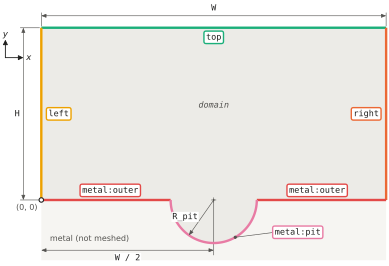
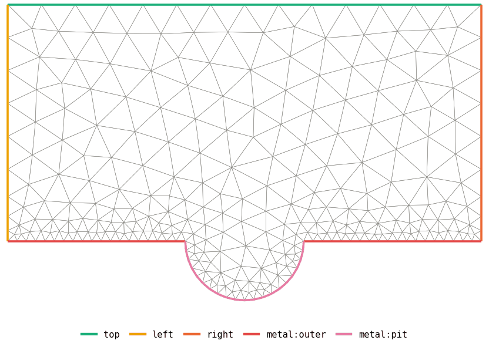

CorrosionPit
============

``MeshType = "CorrosionPit"``: an electrolyte filling the rectangle
``[0, W] x [0, H]`` above a metal surface ``y = 0``, plus a semicircular pit
of radius ``R_pit`` dug into that surface, centred at ``x = W/2``. The
metal itself is not meshed: its surface is the boundary group ``metal``,
split into the pit wall and the flat outer surface, so that different
surface reactions can act on each (see the corrosion pit electrochemistry
example). The mesh is refined to ``dx_metal`` on the metal surface and
grades back to ``dx`` over a distance of ``2 dx``.

Supported dimensions
   ``dim = 2`` only.

   Dimensions and named groups.

   Sample mesh made with these parameters:

.. literalinclude:: ../../scripts/make_mesh_generator_figures.py
   :pyobject: CorrosionPitParams
   :prepend: from femcubes.core.params_template import ParamsTemplate

Parameters
----------

.. list-table::
   :header-rows: 1
   :widths: 16 54 18 12

   * - Name
     - Meaning
     - Required / default
     - Unit
   * - ``dim``
     - Spatial dimension, must be 2
     - required
     - --
   * - ``W``
     - Width of the electrolyte
     - required
     - length
   * - ``H``
     - Height of the electrolyte above the metal surface
     - required
     - length
   * - ``R_pit``
     - Pit radius; smaller than ``W / 2`` and ``H``
     - required
     - length
   * - ``dx``
     - Element size away from the metal
     - required
     - length
   * - ``dx_metal``
     - Element size on the metal surface
     - ``dx``
     - length

Invalid values raise ``ValueError``.

Named groups
------------

Domain
   ``domain`` (the electrolyte)

Boundaries
   ``top`` (``y = H``), ``left`` (``x = 0``), ``right`` (``x = W``), and
   ``metal`` = ``metal:pit`` (the semicircular pit wall) + ``metal:outer``
   (the flat surface ``y = 0`` on both sides of the pit)

API
---

.. automodule:: femcubes.mesh_generators.corrosion_pit
   :members:
   :show-inheritance:
