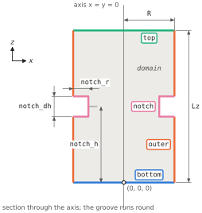
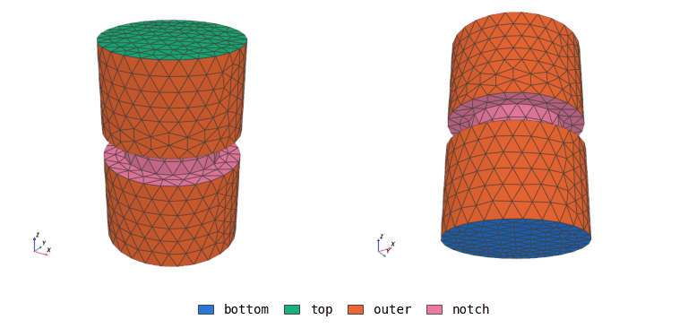

Cylinder
========

``MeshType = "Cylinder"``: a solid cylinder of radius ``R`` and height
``Lz``, with its axis on the ``z`` axis (``x = y = 0``) from ``z = 0`` to
``z = Lz``. With ``notch_r > 0`` a circumferential groove of depth
``notch_r`` and height ``notch_dh`` is cut into the outer surface, centred
at ``z = notch_h``. With ``slot_depth > 0`` a short planar slot is cut into
the outer surface instead, centred at ``(R, 0, slot_h)``, with its surface
trace inclined at ``slot_angle`` to the circumferential direction
(descending in ``z`` towards ``+y``). With the default 45 degrees the slot
lies perpendicular to the largest principal stress of a torsion that turns
the top anticlockwise about ``+z``, so a crack from it starts along the
helical path of a torsion fracture. The element size is ``dx`` everywhere,
smaller where gmsh needs it to resolve the groove or slot.

Supported dimensions
   ``dim = 3`` only.

   Dimensions and named groups, in a section through the axis.

   Sample mesh made with these parameters:

.. literalinclude:: ../../scripts/make_mesh_generator_figures.py
   :pyobject: CylinderParams
   :prepend: from femcubes.core.params_template import ParamsTemplate

Parameters
----------

.. list-table::
   :header-rows: 1
   :widths: 14 56 18 12

   * - Name
     - Meaning
     - Required / default
     - Unit
   * - ``dim``
     - Spatial dimension, must be 3
     - required
     - --
   * - ``R``
     - Cylinder radius
     - required
     - length
   * - ``Lz``
     - Cylinder height
     - required
     - length
   * - ``dx``
     - Element size
     - required
     - length
   * - ``notch_r``
     - Radial depth of the groove; 0 gives a plain cylinder
     - 0.0
     - length
   * - ``notch_h``
     - Height of the groove centre above ``z = 0``
     - ``Lz / 2``
     - length
   * - ``notch_dh``
     - Groove height in ``z``
     - ``dx``
     - length
   * - ``slot_depth``
     - Radial depth of the slot; 0 gives no slot. Not with ``notch_r > 0``
     - 0.0
     - length
   * - ``slot_length``
     - Slot length along the surface
     - ``2 slot_depth``
     - length
   * - ``slot_width``
     - Slot opening
     - ``dx / 2``
     - length
   * - ``slot_h``
     - Height of the slot centre above ``z = 0``
     - ``Lz / 2``
     - length
   * - ``slot_angle``
     - Angle between the slot trace and the circumferential direction
     - 45
     - degree

The groove parameters are not checked; ``notch_r`` should be smaller than
``R`` and the groove should lie within ``0 < z < Lz``. ``slot_depth`` must be
smaller than ``R``, ``slot_length`` and ``slot_width`` positive, and the
groove and the slot cannot be combined.

Named groups
------------

Domain
   ``domain``

Boundaries
   ``bottom`` (``z = 0``), ``top`` (``z = Lz``), ``outer`` (the
   cylindrical surface ``r = R``), and ``notch`` (the groove floor and
   flanks, or the slot faces; only with ``notch_r > 0`` or ``slot_depth > 0``)

API
---

.. automodule:: femcubes.mesh_generators.cylinder
   :members:
   :show-inheritance:
