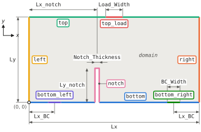
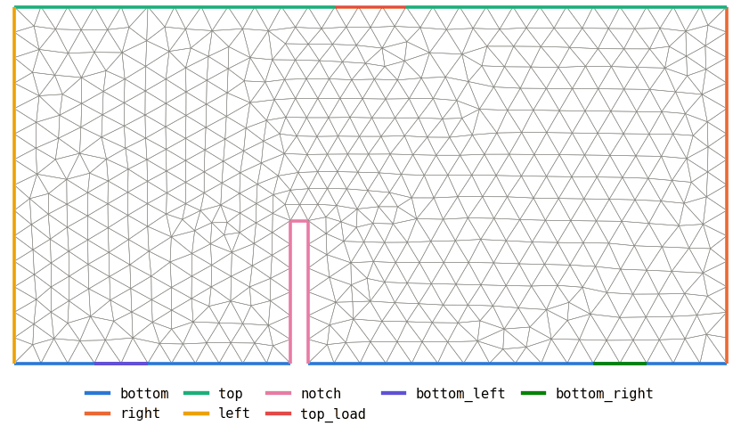
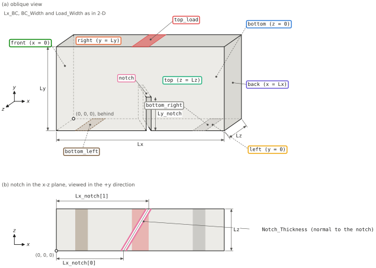
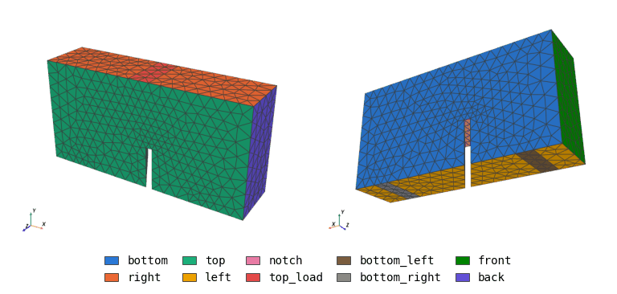

DamageChallenge
===============

``MeshType = "DamageChallenge"``: the damage-challenge benchmark specimen,
a beam ``[0, Lx] x [0, Ly]`` with a notch cut up from its bottom edge and
three boundary windows for loading and support: ``top_load`` centred on the
top edge, and ``bottom_left`` and ``bottom_right`` on the bottom edge at
``Lx_BC`` from either end. The windows are cut out of the edges they lie
on, so every facet carries one group. The element size is ``dx``
everywhere. The specimen is the notched beam of the damage mechanics
challenge, whose participant predictions are compared with the experiments
by :cite:t:`Morris2024`; :cite:t:`Gupta2024` give predictions for it with an
adaptive phase-field implementation.

In 3-D the beam has thickness ``Lz``. The notch runs through it and may be
slanted: with ``Lx_notch = [x0, x1]`` the notch centre lies at ``x = x0`` on
``z = 0`` and at ``x = x1`` on ``z = Lz``.

.. note::

   The 3-D boundary names follow the box convention, not the 2-D names:
   the 2-D bottom edge (``y = 0``) is ``left`` in 3-D, the 2-D top edge
   (``y = Ly``) is ``right``, and ``bottom`` / ``top`` are the faces
   ``z = 0`` / ``z = Lz``. The windows lie on ``y = 0`` and ``y = Ly`` in
   both cases.

Supported dimensions
   ``dim = 2`` or ``dim = 3``.

2-D
---

   Dimensions and named groups in 2-D.

   Sample mesh made with these parameters:

.. literalinclude:: ../../scripts/make_mesh_generator_figures.py
   :pyobject: DamageChallengeParams
   :prepend: from femcubes.core.params_template import ParamsTemplate

3-D
---

   Dimensions and named faces in 3-D: (a) oblique view, with ``z``
   pointing towards the viewer, so the drawn front face is ``top``
   (``z = Lz``); (b) the notch and the windows in the ``x``-``z`` plane.

   Sample mesh made with these parameters:

.. literalinclude:: ../../scripts/make_mesh_generator_figures.py
   :pyobject: DamageChallenge3DParams
   :prepend: from femcubes.core.params_template import ParamsTemplate

Parameters
----------

.. list-table::
   :header-rows: 1
   :widths: 18 52 18 12

   * - Name
     - Meaning
     - Required / default
     - Unit
   * - ``dim``
     - Spatial dimension, 2 or 3
     - required
     - --
   * - ``Lx``, ``Ly``
     - Beam length and height
     - required
     - length
   * - ``Lz``
     - Beam thickness
     - required in 3-D
     - length
   * - ``Lx_notch``
     - ``x`` of the notch centre; in 3-D also a pair ``[x0, x1]``: the
       centre at ``z = 0`` and at ``z = Lz``
     - required
     - length
   * - ``Notch_Thickness``
     - Notch width; in 3-D measured normal to a slanted notch
     - required
     - length
   * - ``Ly_notch``
     - Notch height from ``y = 0``
     - required
     - length
   * - ``Lx_BC``
     - Distance of the support window centres from ``x = 0`` and
       ``x = Lx``
     - required
     - length
   * - ``BC_Width``
     - Width of each support window
     - ``dx``
     - length
   * - ``Load_Width``
     - Width of the load window, centred at ``x = Lx/2``
     - ``dx``
     - length
   * - ``dx``
     - Element size
     - required
     - length

``Load_Width`` and ``BC_Width`` must be positive. A window that lies
entirely within the notch raises ``ValueError`` in 3-D; in 2-D it only
prints a warning and its group stays empty.

Named groups
------------

Domain
   ``domain``

Boundaries in 2-D
   ``bottom`` (``y = 0`` outside the notch and the support windows),
   ``right`` (``x = Lx``), ``top`` (``y = Ly`` outside the load window),
   ``left`` (``x = 0``), ``notch``, ``top_load``, ``bottom_left``,
   ``bottom_right``

Boundaries in 3-D
   ``left`` (``y = 0`` outside the notch and the support windows),
   ``right`` (``y = Ly`` outside the load window), ``front`` (``x = 0``),
   ``back`` (``x = Lx``), ``bottom`` (``z = 0``), ``top`` (``z = Lz``),
   ``notch``, ``top_load``, ``bottom_left``, ``bottom_right``

API
---

.. automodule:: femcubes.mesh_generators.damage_challenge
   :members:
   :show-inheritance:

References
----------

.. bibliography::
   :filter: docname in docnames
