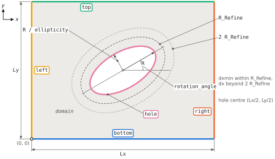
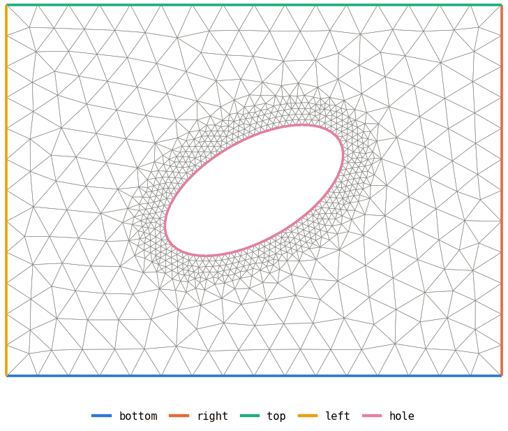
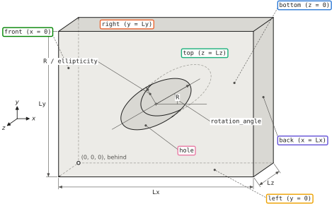
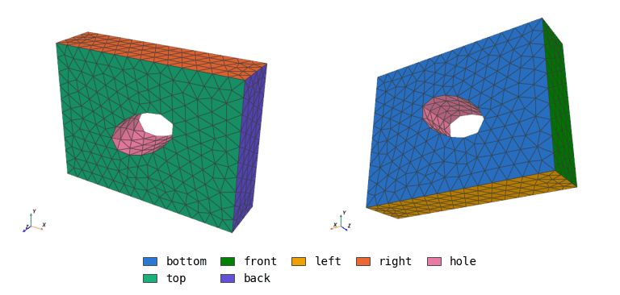

FullPlateWithHole
=================

``MeshType = "FullPlateWithHole"``: the plate ``[0, Lx] x [0, Ly]`` with a
hole centred at ``(Lx/2, Ly/2)``, meshed in full (no symmetry). The hole is
an ellipse with semi-axis ``R`` along its own axis and ``R / ellipticity``
across it, rotated counter-clockwise by ``rotation_angle`` degrees; the
defaults give a circle of radius ``R``. In 2-D the mesh is refined to
``dxmin`` within a distance ``R_Refine`` of the hole and grades to ``dx`` at
``2 R_Refine``. In 3-D the plate has thickness ``Lz``, the hole runs
through it along ``z``, and the element size is ``dx`` everywhere.

Supported dimensions
   ``dim = 2`` or ``dim = 3``.

2-D
---

   Dimensions and named groups in 2-D. The dashed curves lie at
   ``R_Refine`` and ``2 R_Refine`` from the hole.

   Sample mesh made with these parameters:

.. literalinclude:: ../../scripts/make_mesh_generator_figures.py
   :pyobject: FullPlateWithHoleParams
   :prepend: from femcubes.core.params_template import ParamsTemplate

3-D
---

   Dimensions and named faces in 3-D: ``z`` points towards the viewer, so
   the drawn front face is ``top`` (``z = Lz``).

   Sample mesh made with these parameters:

.. literalinclude:: ../../scripts/make_mesh_generator_figures.py
   :pyobject: FullPlateWithHole3DParams
   :prepend: from femcubes.core.params_template import ParamsTemplate

Parameters
----------

.. list-table::
   :header-rows: 1
   :widths: 18 52 18 12

   * - Name
     - Meaning
     - Required / default
     - Unit
   * - ``dim``
     - Spatial dimension, 2 or 3
     - required
     - --
   * - ``Lx``, ``Ly``
     - Plate size in ``x`` and ``y``
     - required
     - length
   * - ``Lz``
     - Plate thickness
     - required in 3-D
     - length
   * - ``R``
     - Semi-axis of the hole along its own axis (radius of a circular hole)
     - required
     - length
   * - ``ellipticity``
     - Ratio of the two semi-axes; the other semi-axis is ``R / ellipticity``
     - 1.0
     - --
   * - ``rotation_angle``
     - Counter-clockwise rotation of the hole about ``z``
     - 0.0
     - degree
   * - ``dx``
     - Element size away from the hole (everywhere in 3-D)
     - required
     - length
   * - ``dxmin``
     - Element size within ``R_Refine`` of the hole; 2-D only
     - ``dx``
     - length
   * - ``R_Refine``
     - Distance from the hole over which ``dxmin`` is kept; the size
       reaches ``dx`` at ``2 R_Refine``; 2-D only
     - ``2 R``
     - length

The generator does not check that the hole fits inside the plate.

Named groups
------------

Domain
   ``domain``

Boundaries in 2-D
   ``bottom`` (``y = 0``), ``right`` (``x = Lx``), ``top`` (``y = Ly``),
   ``left`` (``x = 0``), ``hole``

Boundaries in 3-D
   ``front`` (``x = 0``), ``back`` (``x = Lx``), ``left`` (``y = 0``),
   ``right`` (``y = Ly``), ``bottom`` (``z = 0``), ``top`` (``z = Lz``),
   ``hole``

API
---

.. automodule:: femcubes.mesh_generators.full_plate_with_hole
   :members:
   :show-inheritance:
