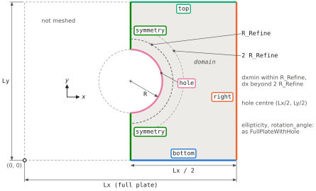
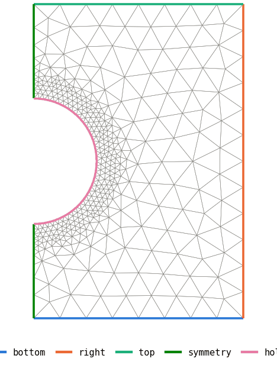

HalfPlateWithHole
=================

``MeshType = "HalfPlateWithHole"``: the right half of
:doc:`full_plate_with_hole`, cut along the vertical line through the hole
centre. Coordinates are those of the full plate: the mesh covers
``Lx/2 <= x <= Lx`` and ``0 <= y <= Ly``, and the hole stays centred at
``(Lx/2, Ly/2)``. **Keep** ``Lx`` **equal to the full plate width**, rather
than halving it. The hole refinement uses the same distance field as the
full plate, so ``dx``, ``dxmin`` and ``R_Refine`` carry over unchanged.

Supported dimensions
   ``dim = 2`` only.

   Dimensions and named groups. The dashed left half is not meshed; the
   dashed arcs lie at ``R_Refine`` and ``2 R_Refine`` from the hole.

   Sample mesh made with these parameters:

.. literalinclude:: ../../scripts/make_mesh_generator_figures.py
   :pyobject: HalfPlateWithHoleParams
   :prepend: from femcubes.core.params_template import ParamsTemplate

Parameters
----------

.. list-table::
   :header-rows: 1
   :widths: 18 52 18 12

   * - Name
     - Meaning
     - Required / default
     - Unit
   * - ``dim``
     - Spatial dimension, must be 2
     - required
     - --
   * - ``Lx``
     - Width of the **full** plate; the mesh starts at ``x = Lx/2``
     - required
     - length
   * - ``Ly``
     - Plate height
     - required
     - length
   * - ``R``
     - Semi-axis of the hole in ``x`` (radius of a circular hole)
     - required
     - length
   * - ``ellipticity``
     - Ratio of the semi-axes, as in ``FullPlateWithHole``
     - 1.0
     - --
   * - ``rotation_angle``
     - Rotation of the hole; a noncircular hole needs a multiple of 90
     - 0.0
     - degree
   * - ``dx``
     - Element size away from the hole
     - required
     - length
   * - ``dxmin``
     - Element size within ``R_Refine`` of the hole
     - ``dx``
     - length
   * - ``R_Refine``
     - Distance from the hole over which ``dxmin`` is kept; the size
       reaches ``dx`` at ``2 R_Refine``
     - ``2 R``
     - length

All sizes must be positive and finite, and the hole must fit strictly
inside the full plate; otherwise ``ValueError`` is raised.

Named groups
------------

Domain
   ``domain``

Boundaries
   ``bottom`` (``y = 0``), ``right`` (``x = Lx``), ``top`` (``y = Ly``),
   ``symmetry`` (both straight segments of ``x = Lx/2``, above and below
   the hole), ``hole`` (the half hole only)

Symmetry conditions and comparisons
-----------------------------------

The generator supplies geometry and markers; boundary conditions remain
explicit model choices. Add this to the mechanical model setup:

.. code-block:: python

   params.Models["BC_Symmetry"] = {
       "Type": "Boundary:PrescribedValue",
       "boundary": "symmetry",
       "field": "u_x",
       "value": 0.0,
   }

Leave ``u_y`` free on ``symmetry``. For a standard phase-field gradient
term, leave the phase field unconstrained there, retaining its natural
zero-normal-gradient condition. Do not suppress damage on this plane.
Other fields and loadings must also respect reflection symmetry; this
domain restricts the solution to symmetric responses.

Keep the full-plate displacement rate unchanged. Multiply the computed top
reaction and extensive integrals (such as total work and energies) by two
for comparison with a full plate. Equivalently, compute nominal stress
using the half-plate width ``Lx/2``. Local stresses, strains and
phase-field values need no factor of two.

API
---

.. automodule:: femcubes.mesh_generators.half_plate_with_hole
   :members:
   :show-inheritance:
