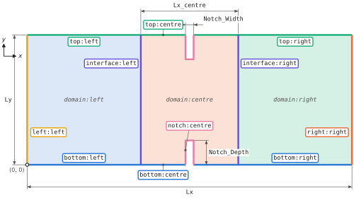
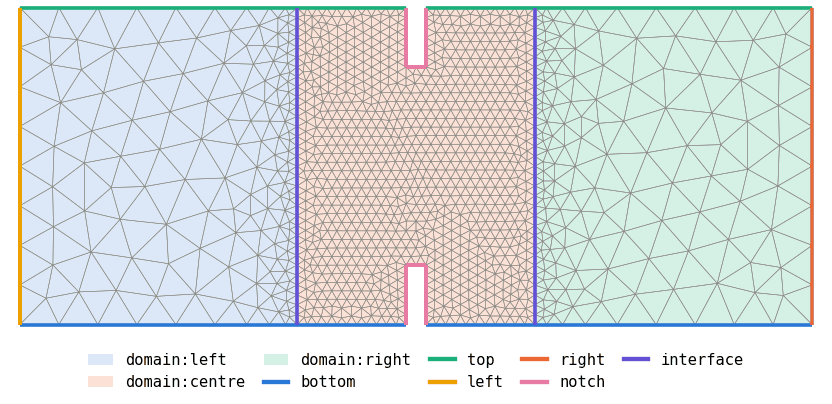

NotchedTensileBar
=================

``MeshType = "NotchedTensileBar"``: the tensile bar ``[0, Lx] x [0, Ly]``,
loaded through its ``left`` and ``right`` ends, with rectangular notches of
width ``Notch_Width`` and depth ``Notch_Depth`` cut into the top and/or
bottom edge at ``x = Lx/2``. The bar is split into three conforming cell
domains: a centre region of width ``Lx_centre`` around the notches, and the
two outer regions. The lines between them are interior facet groups. This
is meant for multi-domain models, for example a fracture model in the
centre domain only.

The centre domain is meshed with ``dx_centre``; the outer domains grade
from ``dx_centre`` at the interfaces back to ``dx`` over a distance of
``2 dx``.

Supported dimensions
   ``dim = 2`` only.

   Dimensions and named groups. Each boundary name is ``group:domain``;
   the colour shows the group.

   Sample mesh made with these parameters (boundaries coloured by group):

.. literalinclude:: ../../scripts/make_mesh_generator_figures.py
   :pyobject: NotchedTensileBarParams
   :prepend: from femcubes.core.params_template import ParamsTemplate

Parameters
----------

.. list-table::
   :header-rows: 1
   :widths: 16 54 18 12

   * - Name
     - Meaning
     - Required / default
     - Unit
   * - ``dim``
     - Spatial dimension, must be 2
     - required
     - --
   * - ``Lx``, ``Ly``
     - Bar length (loading direction) and height
     - required
     - length
   * - ``Lx_centre``
     - Width of the centre domain, centred at ``x = Lx/2``; larger than
       ``Notch_Width`` and smaller than ``Lx``
     - required
     - length
   * - ``Notch_Width``
     - Width of each notch
     - required
     - length
   * - ``Notch_Depth``
     - Depth of each notch; smaller than ``Ly / 2`` with two notches,
       smaller than ``Ly`` with one
     - required
     - length
   * - ``Notch_Sides``
     - Notched edges: ``"both"``, ``"top"`` or ``"bottom"``
     - ``"both"``
     - --
   * - ``dx``
     - Element size in the outer domains
     - required
     - length
   * - ``dx_centre``
     - Element size in the centre domain
     - ``dx``
     - length

Invalid values raise ``ValueError``.

Named groups
------------

Domains
   ``domain`` = ``domain:left`` + ``domain:centre`` + ``domain:right``

Boundaries
   ``bottom`` = ``bottom:left`` + ``bottom:centre`` + ``bottom:right``
   (``y = 0``); ``top`` = ``top:left`` + ``top:centre`` + ``top:right``
   (``y = Ly``); ``left`` = ``left:left`` (``x = 0``); ``right`` =
   ``right:right`` (``x = Lx``); ``notch`` = ``notch:centre``

Interior facets
   ``interface`` = ``interface:left`` (between ``domain:left`` and
   ``domain:centre``, at ``x = (Lx - Lx_centre)/2``) +
   ``interface:right`` (between ``domain:centre`` and ``domain:right``, at
   ``x = (Lx + Lx_centre)/2``)

API
---

.. automodule:: femcubes.mesh_generators.notched_tensile_bar
   :members:
   :show-inheritance:
