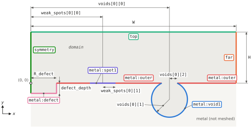
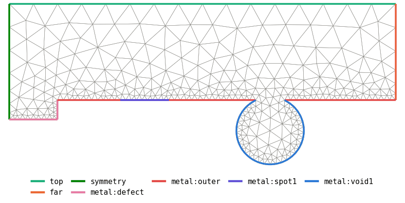
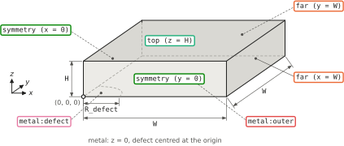
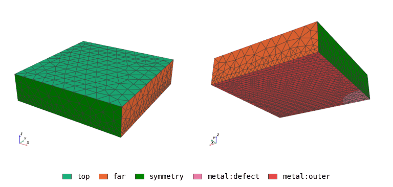

PlateWithDefect
===============

``MeshType = "PlateWithDefect"``: an electrolyte layer of thickness ``H`` on
a flat metal plate with a circular defect of radius ``R_defect``, using
symmetry. In 2-D the domain is the half ``[0, W] x [0, H]``, with the defect
centre on the symmetry axis ``x = 0``; in 3-D it is the quarter
``[0, W] x [0, W] x [0, H]``, with the defect centre on the intersection of
the symmetry planes ``x = 0`` and ``y = 0``. The metal is not meshed: its
surface (``y = 0`` in 2-D, ``z = 0`` in 3-D) is a boundary group split into
the defect and the surrounding outer surface, so that the surface models
can differ between them (the pit nucleation setup of the corrosion study).

In 2-D the metal surface can also carry weak spots (surface segments with
their own group), voids (cavities in the metal under the surface that open
into the electrolyte) and a recessed defect (a pit cavity). With
``Axisymmetric = True`` the half domain is the r-z plane of a disc of radius
``W`` with the defect at its centre; weak spots and voids then become rings.

Supported dimensions
   ``dim = 2`` (half domain) or ``dim = 3`` (quarter domain).

2-D
---

   Dimensions and named groups in 2-D, with the optional ``defect_depth``,
   one weak spot and one void. Without them the metal surface is the flat
   line ``y = 0``, split at ``x = R_defect``.

   Sample mesh made with these parameters:

.. literalinclude:: ../../scripts/make_mesh_generator_figures.py
   :pyobject: PlateWithDefectParams
   :prepend: from femcubes.core.params_template import ParamsTemplate

3-D
---

   Dimensions and named faces in 3-D. The metal face ``z = 0`` is hidden;
   the dashed arc is the edge of the defect.

   Sample mesh made with these parameters:

.. literalinclude:: ../../scripts/make_mesh_generator_figures.py
   :pyobject: PlateWithDefect3DParams
   :prepend: from femcubes.core.params_template import ParamsTemplate

Parameters
----------

.. list-table::
   :header-rows: 1
   :widths: 18 54 16 12

   * - Name
     - Meaning
     - Required / default
     - Unit
   * - ``dim``
     - Spatial dimension, 2 or 3
     - required
     - --
   * - ``W``
     - Extent of the domain from the defect centre (2-D: width; 3-D: side
       of the square)
     - required
     - length
   * - ``H``
     - Thickness of the electrolyte layer
     - required
     - length
   * - ``R_defect``
     - Defect radius; smaller than ``W``
     - required
     - length
   * - ``dx``
     - Element size away from the metal
     - required
     - length
   * - ``dx_metal``
     - Element size on the metal surface, grading to ``dx`` over ``2 dx``
     - ``dx``
     - length
   * - ``dx_defect``
     - Element size at the edge of the defect, grading over ``R_defect``
     - ``dx_metal``
     - length
   * - ``dx_pit``
     - Element size on the whole defect surface, grading over
       ``R_defect``; used only when smaller than ``dx_metal``
     - ``dx_metal``
     - length
   * - ``grading``
     - If given (> 0), sizes grow linearly with the distance ``d`` from
       each refined feature instead of the fixed ramps:
       ``min(dx, dx_metal + grading d_metal, dx_pit + grading d_pit,
       dx_defect + grading d_edge)``
     - ``None``
     - --
   * - ``lateral_grading``
     - If given (> 0), sizes also grow with the distance ``d`` from the
       defect edge along the plate, through the whole layer:
       ``min(dx_far, max(size, dx_metal + lateral_grading max(0, d -
       fine_extent)))``; requires ``dx_far``
     - ``None``
     - --
   * - ``dx_far``
     - Largest element size, with ``lateral_grading``
     - required with ``lateral_grading``
     - length
   * - ``fine_extent``
     - Distance from the defect edge without lateral coarsening
     - 0
     - length
   * - ``feature_extent``
     - Distance from the edges of the weak spots and the mouths of the
       voids without lateral coarsening
     - ``fine_extent``
     - length
   * - ``weak_spots``
     - 2-D only: sequence of ``(centre, half_width)`` segments of the outer
       surface with their own groups, within ``(R_defect, W)`` and not
       overlapping; their edges are refined like the defect edge
     - ``None``
     - length
   * - ``defect_depth``
     - 2-D only: depth of a recess ``[0, R_defect] x [-defect_depth, 0]``
       in place of the flat defect
     - 0
     - length
   * - ``voids``
     - 2-D only: sequence of ``(centre, radius, mouth)``: a circle of
       ``radius`` below the surface, opening into the electrolyte through
       ``[centre - mouth, centre + mouth]`` (``0 < mouth < radius``); its
       centre lies ``sqrt(radius^2 - mouth^2)`` below the surface. Within
       ``(R_defect, W)``, not overlapping each other or the weak spots
     - ``None``
     - length
   * - ``dx_void``
     - Element size on the void walls, grading back over one void radius
     - ``dx_defect``
     - length
   * - ``Axisymmetric``
     - Mesh option, 2-D only: the half domain is the r-z plane of a disc
     - ``False``
     - --

Invalid values raise ``ValueError``.

Named groups
------------

Domain
   ``domain`` (the electrolyte)

Boundaries
   ``top`` (``y = H`` in 2-D, ``z = H`` in 3-D), ``far`` (``x = W``, and
   ``y = W`` in 3-D), ``symmetry`` (``x = 0``, and ``y = 0`` in 3-D; in 2-D
   including the wall of a recessed defect on ``x = 0``), and ``metal`` =
   ``metal:defect`` + ``metal:outer`` (+ ``metal:spot1``, ``metal:spot2``,
   ... with ``weak_spots``, and ``metal:void1``, ... with ``voids``,
   numbered outwards from the defect)

Further examples
----------------

A graded mesh for a thick electrolyte, refined at an active pit:

.. code-block:: python

   class ThickLayerParams(ParamsTemplate):
       MeshType = "PlateWithDefect"
       dim = 2
       W = 10.0e-3
       H = 10.0e-3
       R_defect = 0.5e-3
       dx = 1.0e-3
       dx_metal = 2.0e-5
       dx_pit = 1.0e-5
       dx_defect = 2.0e-6
       grading = 0.2

A 300 mm plate (half domain) under a 100 um water film, fine within 10 mm of
the defect and coarsening to 1 mm towards the far end:

.. code-block:: python

   class LongPlateParams(ParamsTemplate):
       MeshType = "PlateWithDefect"
       dim = 2
       W = 0.15
       H = 1.0e-4
       R_defect = 0.5e-3
       dx = 4.0e-5
       dx_metal = 2.0e-5
       dx_defect = 4.0e-6
       lateral_grading = 0.05
       dx_far = 1.0e-3
       fine_extent = 10.0e-3

The same plate with two weak spots (e.g. grains with their own surface
model) of 0.2 mm at 30 and 60 mm from the defect centre:

.. code-block:: python

   class WeakSpotParams(LongPlateParams):
       weak_spots = [(0.03, 1.0e-4), (0.06, 1.0e-4)]

API
---

.. automodule:: femcubes.mesh_generators.plate_with_defect
   :members:
   :show-inheritance:
