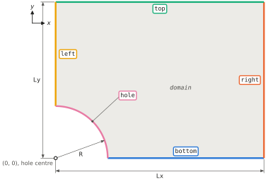
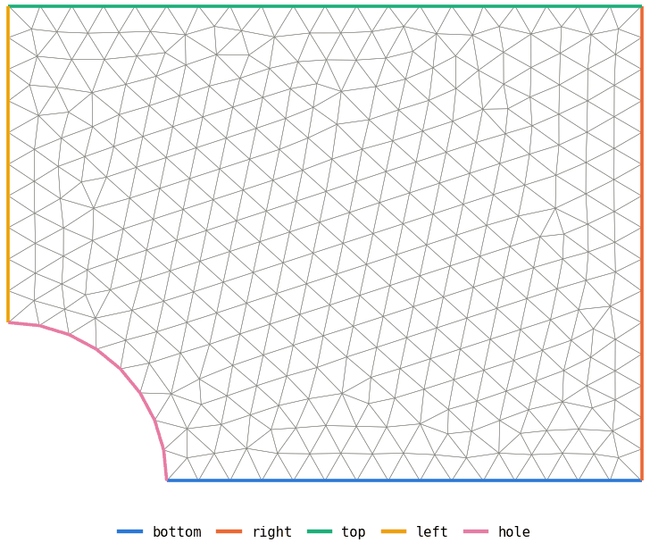
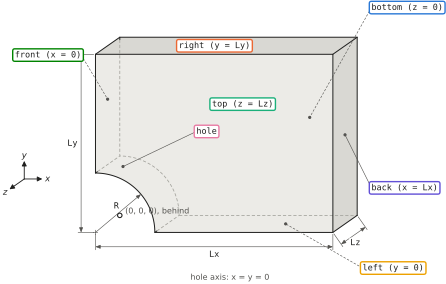
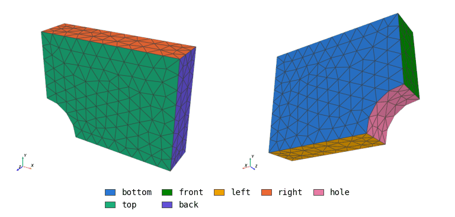

PlateWithHole
=============

``MeshType = "PlateWithHole"``: one quarter of a plate with a circular
hole, for problems symmetric about ``x = 0`` and ``y = 0``. The hole of
radius ``R`` is centred at the origin, and the domain is
``[0, Lx] x [0, Ly]`` outside the hole. In 3-D the plate has thickness
``Lz`` and the hole runs through it along ``z``.

The symmetry conditions on ``left`` and ``bottom`` (2-D) are model choices;
the generator applies none.

Supported dimensions
   ``dim = 2`` or ``dim = 3``.

2-D
---

   Dimensions and named groups in 2-D.

   Sample mesh made with these parameters:

.. literalinclude:: ../../scripts/make_mesh_generator_figures.py
   :pyobject: PlateWithHoleParams
   :prepend: from femcubes.core.params_template import ParamsTemplate

3-D
---

   Dimensions and named faces in 3-D: ``z`` points towards the viewer, so
   the drawn front face is ``top`` (``z = Lz``).

   Sample mesh made with these parameters:

.. literalinclude:: ../../scripts/make_mesh_generator_figures.py
   :pyobject: PlateWithHole3DParams
   :prepend: from femcubes.core.params_template import ParamsTemplate

Parameters
----------

.. list-table::
   :header-rows: 1
   :widths: 14 56 18 12

   * - Name
     - Meaning
     - Required / default
     - Unit
   * - ``dim``
     - Spatial dimension, 2 or 3
     - required
     - --
   * - ``Lx``, ``Ly``
     - Size of the quarter plate in ``x`` and ``y``
     - required
     - length
   * - ``Lz``
     - Plate thickness
     - required in 3-D
     - length
   * - ``R``
     - Hole radius; must be smaller than ``Lx`` and ``Ly`` (not checked)
     - required
     - length
   * - ``dx``
     - Element size (uniform, no refinement at the hole)
     - required
     - length

For an elliptical or rotated hole, or for refinement at the hole, use
:doc:`full_plate_with_hole` or :doc:`half_plate_with_hole`.

Named groups
------------

Domain
   ``domain``

Boundaries in 2-D
   ``bottom`` (``y = 0``, ``R <= x <= Lx``), ``right`` (``x = Lx``),
   ``top`` (``y = Ly``), ``left`` (``x = 0``, ``R <= y <= Ly``), ``hole``

Boundaries in 3-D
   ``front`` (``x = 0``), ``back`` (``x = Lx``), ``left`` (``y = 0``),
   ``right`` (``y = Ly``), ``bottom`` (``z = 0``), ``top`` (``z = Lz``),
   ``hole``

API
---

.. automodule:: femcubes.mesh_generators.plate_with_hole
   :members:
   :show-inheritance:
