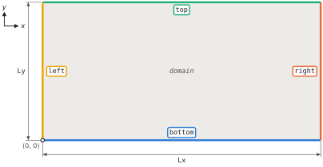
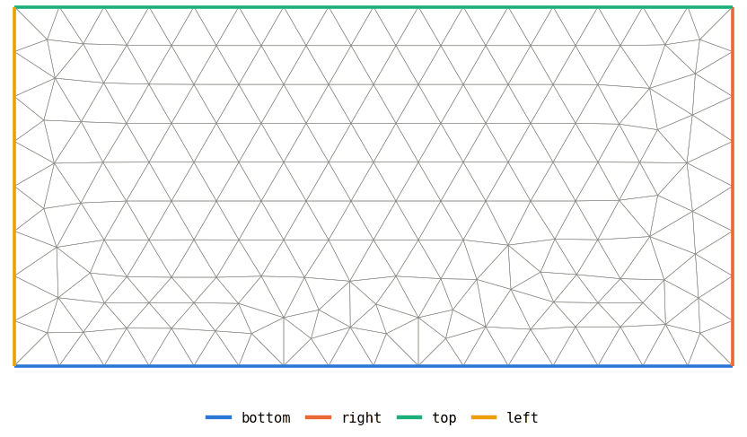
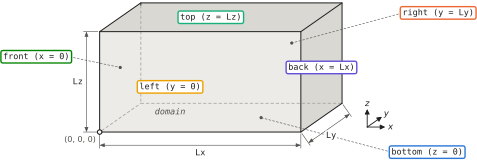
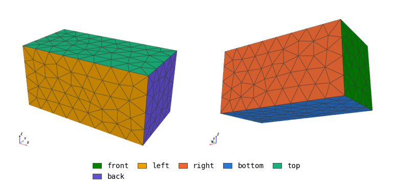

Rectangle
=========

``MeshType = "Rectangle"``: the rectangle ``[0, Lx] x [0, Ly]`` or the box
``[0, Lx] x [0, Ly] x [0, Lz]``, without internal features.

Supported dimensions
   ``dim = 2`` or ``dim = 3``.

2-D
---

   Dimensions and named groups in 2-D.

   Sample mesh made with these parameters:

.. literalinclude:: ../../scripts/make_mesh_generator_figures.py
   :pyobject: RectangleParams
   :prepend: from femcubes.core.params_template import ParamsTemplate

3-D
---

   Dimensions and named faces in 3-D. Dashed leaders point to hidden faces.

   Sample mesh made with these parameters:

.. literalinclude:: ../../scripts/make_mesh_generator_figures.py
   :pyobject: Rectangle3DParams
   :prepend: from femcubes.core.params_template import ParamsTemplate

Parameters
----------

.. list-table::
   :header-rows: 1
   :widths: 14 56 18 12

   * - Name
     - Meaning
     - Required / default
     - Unit
   * - ``dim``
     - Spatial dimension, 2 or 3
     - required
     - --
   * - ``Lx``
     - Size in ``x``
     - required
     - length
   * - ``Ly``
     - Size in ``y``
     - required
     - length
   * - ``Lz``
     - Size in ``z``
     - required in 3-D
     - length
   * - ``dx``
     - Element size
     - required
     - length

Named groups
------------

Domain
   ``domain``

Boundaries in 2-D
   ``bottom`` (``y = 0``), ``right`` (``x = Lx``), ``top`` (``y = Ly``),
   ``left`` (``x = 0``)

Boundaries in 3-D
   ``front`` (``x = 0``), ``back`` (``x = Lx``), ``left`` (``y = 0``),
   ``right`` (``y = Ly``), ``bottom`` (``z = 0``), ``top`` (``z = Lz``)

API
---

.. automodule:: femcubes.mesh_generators.rectangle
   :members:
   :show-inheritance:
