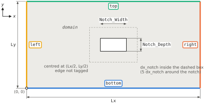
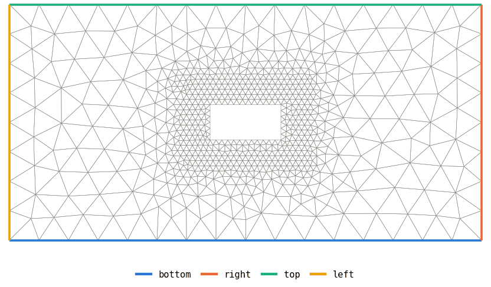

Rectangle_CentreNotch
=====================

``MeshType = "Rectangle_CentreNotch"``: the rectangle ``[0, Lx] x [0, Ly]``
with a rectangular hole of ``Notch_Width`` by ``Notch_Depth`` centred at
``(Lx/2, Ly/2)``. The mesh is refined to ``dx_notch`` in a box that extends
``5 dx_notch`` beyond the hole, and grades to ``dx`` over ``2 dx``.

The boundary of the hole has no boundary group, so no boundary condition
can be applied to it by name: every model keeps its natural boundary
condition there.

Supported dimensions
   ``dim = 2`` only.

   Dimensions and named groups. The dashed box is the refined region.

   Sample mesh made with these parameters:

.. literalinclude:: ../../scripts/make_mesh_generator_figures.py
   :pyobject: RectangleCentreNotchParams
   :prepend: from femcubes.core.params_template import ParamsTemplate

Parameters
----------

.. list-table::
   :header-rows: 1
   :widths: 16 54 18 12

   * - Name
     - Meaning
     - Required / default
     - Unit
   * - ``dim``
     - Spatial dimension, must be 2
     - required
     - --
   * - ``Lx``, ``Ly``
     - Size in ``x`` and ``y``
     - required
     - length
   * - ``Notch_Width``
     - Size of the hole in ``x``
     - required
     - length
   * - ``Notch_Depth``
     - Size of the hole in ``y``
     - required
     - length
   * - ``dx``
     - Element size away from the hole
     - required
     - length
   * - ``dx_notch``
     - Element size in the box around the hole
     - required
     - length

The generator does not check that the hole fits inside the rectangle.

Named groups
------------

Domain
   ``domain``

Boundaries
   ``bottom`` (``y = 0``), ``right`` (``x = Lx``), ``top`` (``y = Ly``),
   ``left`` (``x = 0``); the hole boundary is not tagged

API
---

.. automodule:: femcubes.mesh_generators.rectangle_centre_notch
   :members:
   :show-inheritance:
