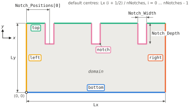
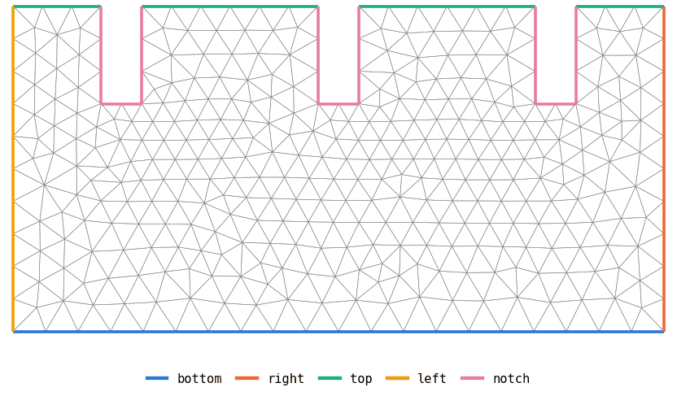
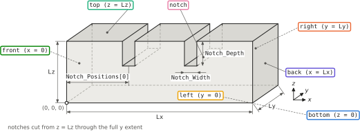
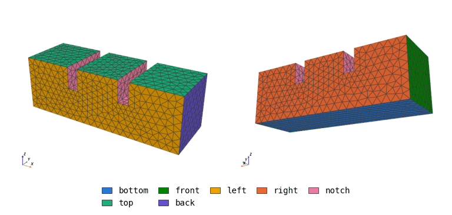

Rectangle_Notches
=================

``MeshType = "Rectangle_Notches"``: a rectangle (2-D) or box (3-D) with
rectangular notches cut into its top side. Use it when a notch should be
part of the mesh geometry rather than an initial damage field. In 2-D the
notches are cut down from ``y = Ly``; in 3-D they are cut down from
``z = Lz`` and run through the full ``y`` extent, or over part of it with
``Notch_Y_Ranges``. Without notches
(``nNotches = 0`` and no ``Notch_Positions``) the domain is a plain
rectangle or box.

Supported dimensions
   ``dim = 2`` or ``dim = 3``.

2-D
---

   Dimensions and named groups in 2-D.

   Sample mesh made with these parameters:

.. literalinclude:: ../../scripts/make_mesh_generator_figures.py
   :pyobject: RectangleNotchesParams
   :prepend: from femcubes.core.params_template import ParamsTemplate

3-D
---

   Dimensions and named faces in 3-D. The notch parameters act in the
   ``x``-``z`` plane.

   Sample mesh made with these parameters:

.. literalinclude:: ../../scripts/make_mesh_generator_figures.py
   :pyobject: RectangleNotches3DParams
   :prepend: from femcubes.core.params_template import ParamsTemplate

Parameters
----------

.. list-table::
   :header-rows: 1
   :widths: 18 52 18 12

   * - Name
     - Meaning
     - Required / default
     - Unit
   * - ``dim``
     - Spatial dimension, 2 or 3
     - required
     - --
   * - ``Lx``, ``Ly``
     - Size in ``x`` and ``y``
     - required
     - length
   * - ``Lz``
     - Size in ``z``
     - required in 3-D
     - length
   * - ``dx``
     - Element size
     - required
     - length
   * - ``nNotches``
     - Number of notches, centred at ``Lx (i + 1/2) / nNotches``; ignored
       when ``Notch_Positions`` is given
     - 0
     - --
   * - ``Notch_Positions``
     - Sequence of notch centres in ``x``
     - optional
     - length
   * - ``Notch_Width``
     - Notch width in ``x``; positive and smaller than ``Lx``
     - ``2 dx``
     - length
   * - ``Notch_Depth``
     - Notch depth from the top; positive and smaller than ``Ly`` (2-D)
       or ``Lz`` (3-D)
     - ``5 dx``
     - length
   * - ``Notch_Y_Ranges``
     - 3-D only: extent ``(y_min, y_max)`` of the notches in ``y``, one pair
       for all notches or one pair per notch (in the order of the notch
       centres); ``0 <= y_min < y_max <= Ly``
     - full width ``(0, Ly)``
     - length

Every notch must lie within ``[0, Lx]`` and notches must not overlap in
``x``; otherwise ``ValueError`` is raised. In 3-D the notches cut through
the full width unless ``Notch_Y_Ranges`` is given; the ends of shorter
notches belong to the ``notch`` group.

Named groups
------------

Domain
   ``domain``

Boundaries in 2-D
   ``bottom`` (``y = 0``), ``right`` (``x = Lx``), ``top`` (the parts of
   ``y = Ly`` between the notches), ``left`` (``x = 0``), and ``notch``
   (walls and bottoms of all notches; only when there are notches)

Boundaries in 3-D
   ``front`` (``x = 0``), ``back`` (``x = Lx``), ``left`` (``y = 0``),
   ``right`` (``y = Ly``), ``bottom`` (``z = 0``), ``top`` (the parts of
   ``z = Lz`` between the notches), and ``notch`` (only when there are
   notches)

API
---

.. automodule:: femcubes.mesh_generators.rectangle_notches
   :members:
   :show-inheritance:
