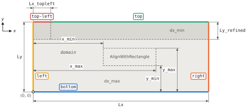
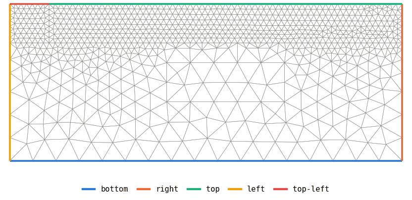

Rectangle_RefinedTop
====================

``MeshType = "Rectangle_RefinedTop"``: the rectangle ``[0, Lx] x [0, Ly]``
with element size ``dx_min`` in the top layer ``Ly - Ly_refined <= y <= Ly``
and ``dx_max`` below it. A vertical edge at ``x = Lx_topleft`` in the top
layer splits the top side into the narrow ``top-left`` strip (for example
for a localised influx) and ``top``. With ``AlignWithRectangle``, the mesh
also conforms to the edges of a given rectangle, so that a field
discontinuity on that rectangle follows element edges.

Supported dimensions
   ``dim = 2`` only.

   Dimensions and named groups. The shaded layer is meshed with ``dx_min``;
   the dashed rectangle is the optional ``AlignWithRectangle``.

   Sample mesh made with these parameters:

.. literalinclude:: ../../scripts/make_mesh_generator_figures.py
   :pyobject: RectangleRefinedTopParams
   :prepend: from femcubes.core.params_template import ParamsTemplate

Parameters
----------

.. list-table::
   :header-rows: 1
   :widths: 20 50 18 12

   * - Name
     - Meaning
     - Required / default
     - Unit
   * - ``dim``
     - Spatial dimension, must be 2
     - required
     - --
   * - ``Lx``, ``Ly``
     - Size in ``x`` and ``y``
     - required
     - length
   * - ``Ly_refined``
     - Thickness of the refined top layer; must be smaller than ``Ly``
     - required
     - length
   * - ``dx_min``
     - Element size in the top layer
     - required
     - length
   * - ``dx_max``
     - Element size below the top layer
     - required
     - length
   * - ``Lx_topleft``
     - Width of the ``top-left`` boundary group
     - ``dx_min``
     - length
   * - ``AlignWithRectangle``
     - Dict with ``x_min`` (default 0), ``x_max``, ``y_min`` and ``y_max``
       of a rectangle whose edges the mesh follows
     - ``None``
     - length

This generator has no ``dx`` parameter. Only ``Ly_refined < Ly`` is
checked; ``Lx_topleft`` should lie in ``(0, Lx)``.

Named groups
------------

Domain
   ``domain`` (one group; the layers and the aligned rectangle are not
   separate domains)

Boundaries
   ``bottom`` (``y = 0``), ``right`` (``x = Lx``), ``left`` (``x = 0``),
   ``top-left`` (``y = Ly``, ``0 <= x <= Lx_topleft``) and ``top``
   (``y = Ly``, ``Lx_topleft <= x <= Lx``)

API
---

.. automodule:: femcubes.mesh_generators.rectangle_refined_top
   :members:
   :show-inheritance:
