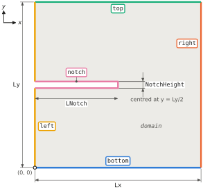
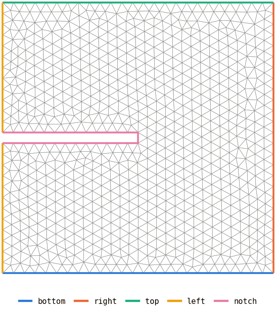
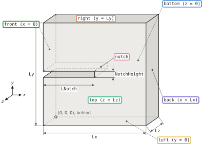
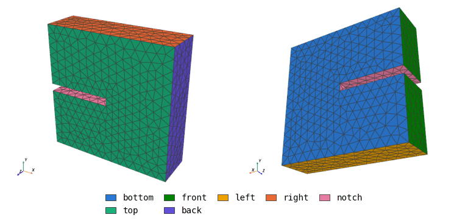

SingleEdgeNotched
=================

``MeshType = "SingleEdgeNotched"``: the plate ``[0, Lx] x [0, Ly]`` with
one rectangular notch cut in from the left edge ``x = 0``. The notch has
length ``LNotch`` and height ``NotchHeight`` and is centred at
``y = Ly/2``. In 3-D the plate has thickness ``Lz`` and the notch runs
through it along ``z``. The element size is ``dx`` everywhere.

Supported dimensions
   ``dim = 2`` or ``dim = 3``.

2-D
---

   Dimensions and named groups in 2-D.

   Sample mesh made with these parameters:

.. literalinclude:: ../../scripts/make_mesh_generator_figures.py
   :pyobject: SingleEdgeNotchedParams
   :prepend: from femcubes.core.params_template import ParamsTemplate

3-D
---

   Dimensions and named faces in 3-D: ``z`` points towards the viewer, so
   the drawn front face is ``top`` (``z = Lz``). The notch opens in the
   ``front`` face (``x = 0``).

   Sample mesh made with these parameters:

.. literalinclude:: ../../scripts/make_mesh_generator_figures.py
   :pyobject: SingleEdgeNotched3DParams
   :prepend: from femcubes.core.params_template import ParamsTemplate

Parameters
----------

.. list-table::
   :header-rows: 1
   :widths: 16 54 18 12

   * - Name
     - Meaning
     - Required / default
     - Unit
   * - ``dim``
     - Spatial dimension, 2 or 3
     - required
     - --
   * - ``Lx``, ``Ly``
     - Plate size in ``x`` and ``y``
     - required
     - length
   * - ``Lz``
     - Plate thickness
     - required in 3-D
     - length
   * - ``LNotch``
     - Notch length from ``x = 0``
     - required
     - length
   * - ``NotchHeight``
     - Notch height, centred at ``y = Ly/2``; raised to at least
       ``1e-6 Ly``
     - ``dx``
     - length
   * - ``dx``
     - Element size
     - required
     - length

Named groups
------------

Domain
   ``domain``

Boundaries in 2-D
   ``bottom`` (``y = 0``), ``right`` (``x = Lx``), ``top`` (``y = Ly``),
   ``left`` (``x = 0``, above and below the notch), ``notch`` (the three
   notch faces)

Boundaries in 3-D
   ``front`` (``x = 0``, above and below the notch), ``back``
   (``x = Lx``), ``left`` (``y = 0``), ``right`` (``y = Ly``), ``bottom``
   (``z = 0``), ``top`` (``z = Lz``), ``notch``

API
---

.. automodule:: femcubes.mesh_generators.single_edge_notched
   :members:
   :show-inheritance:
