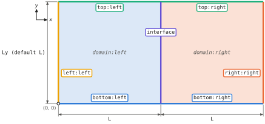
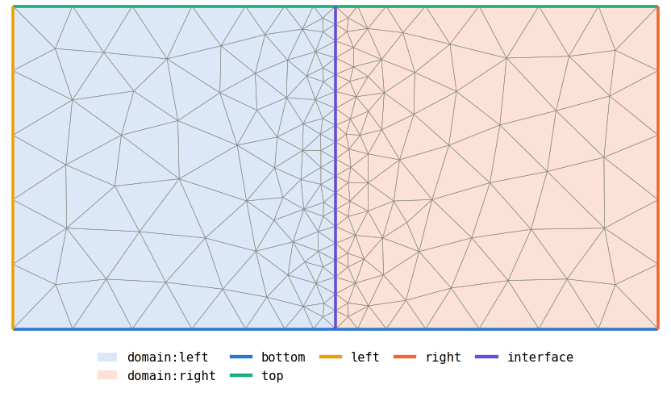

TwoSquared
==========

``MeshType = "TwoSquared"``: two adjacent rectangles, ``[0, L] x [0, Ly]``
and ``[L, 2L] x [0, Ly]``, as two conforming cell domains sharing the
vertical interface ``x = L``. With the default ``Ly = L`` they are two
squares; a small ``Ly`` gives a strip for quasi one-dimensional problems.
It is meant for coupled problems with different physics on either side,
for example an electrolyte next to a metal. The mesh is refined to
``dx_interface`` at the interface and grades back to ``dx`` over a
distance of ``2 dx`` on both sides.

Supported dimensions
   ``dim = 2`` only.

   Dimensions and named groups. Each boundary name is ``group:domain``;
   the colour shows the group.

   Sample mesh made with these parameters (boundaries coloured by group):

.. literalinclude:: ../../scripts/make_mesh_generator_figures.py
   :pyobject: TwoSquaredParams
   :prepend: from femcubes.core.params_template import ParamsTemplate

Parameters
----------

.. list-table::
   :header-rows: 1
   :widths: 16 54 18 12

   * - Name
     - Meaning
     - Required / default
     - Unit
   * - ``dim``
     - Spatial dimension, must be 2
     - required
     - --
   * - ``L``
     - Width of each rectangle
     - required
     - length
   * - ``Ly``
     - Height of both rectangles
     - ``L``
     - length
   * - ``dx``
     - Element size away from the interface
     - required
     - length
   * - ``dx_interface``
     - Element size at the interface
     - ``dx``
     - length

Non-positive values raise ``ValueError``.

Named groups
------------

Domains
   ``domain`` = ``domain:left`` + ``domain:right``

Boundaries
   ``bottom`` = ``bottom:left`` + ``bottom:right`` (``y = 0``); ``top`` =
   ``top:left`` + ``top:right`` (``y = Ly``); ``left`` = ``left:left``
   (``x = 0``); ``right`` = ``right:right`` (``x = 2L``)

Interior facets
   ``interface`` (``x = L``, between ``domain:left`` and ``domain:right``)

API
---

.. automodule:: femcubes.mesh_generators.two_squared
   :members:
   :show-inheritance:
