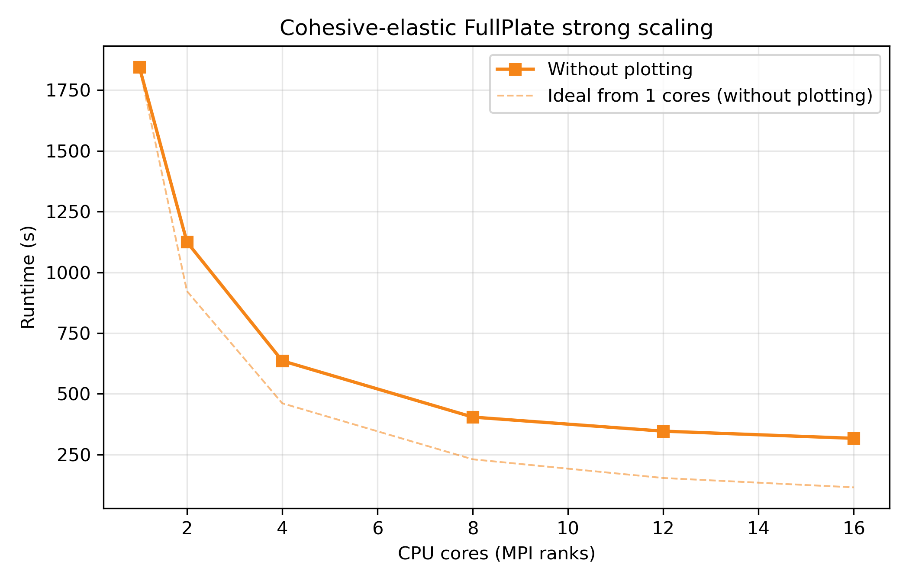
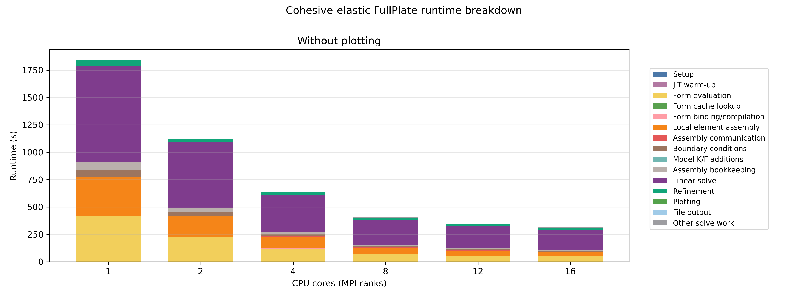
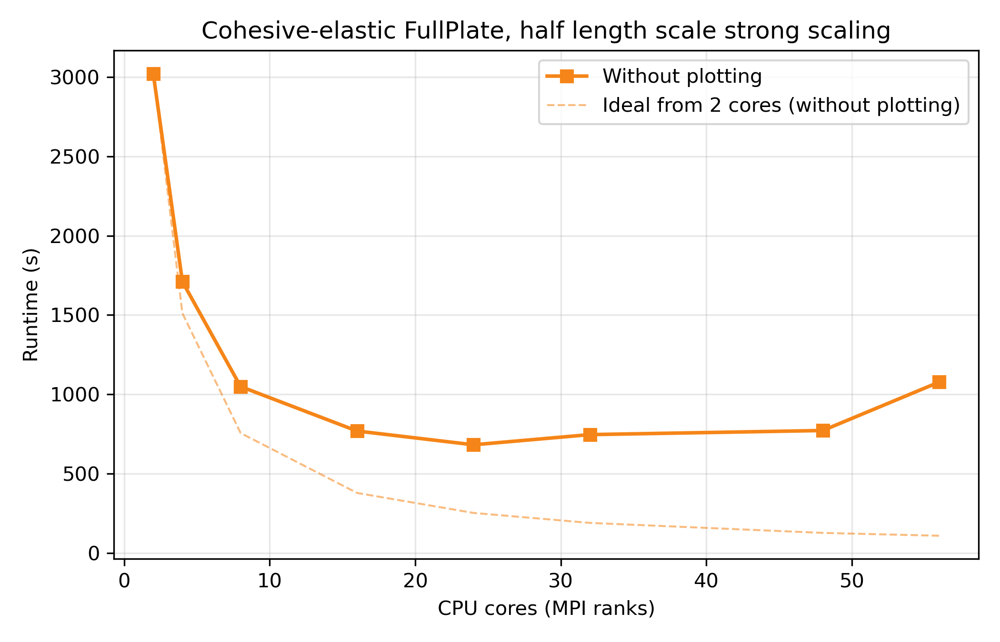
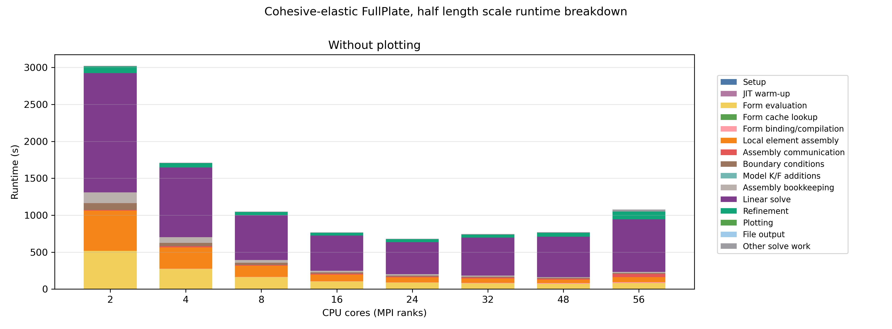

Strong Scaling of the Cohesive Plate
====================================

This benchmark considers the parallel performance of FEMCubes for a fracture
problem with adaptive mesh refinement. Rather than demonstrating a model, it
measures how the run time of a single problem decreases as the number of MPI
ranks is increased (strong scaling), and which parts of the solution
procedure limit this decrease. As the problem size is fixed, ideal scaling
would halve the run time with every doubling of the number of ranks; the
deviation from this ideal shows which operations do not distribute their work
evenly, or whose communication outweighs the work per rank.

Set-up
------

The benchmark runs the ``full_plate`` case of
``examples/fracture/cohesive_phasefield.py`` (see
:doc:`../fracture/cohesive_phasefield`) unchanged, apart from switching off
field files and movies.

The driver runs the whole sweep of rank counts twice, first with plotting
(the final figures are saved) and then without (``--plotting`` selects one of
the two). Each run is launched as a separate MPI job, with one thread per
rank: OpenMP (which also threads the direct solver MUMPS
:cite:p:`Amestoy2001,Amestoy2019`), the BLAS library and numba are limited to
one thread. The run time of a run is the sum of the maximum set-up, JIT
warm-up and solve wall times over all ranks; MPI start-up and Python import
time are recorded separately.

Options
-------

``--cores N [N ...]``
   rank counts to run (default: every even count from 56 down to 2);
``--repetitions``
   independent repetitions at each rank count (default 1);
``--end-time``
   stop the plate at this time instead of its full end time, for short
   studies;
``--linear-solver``
   ``LU`` (default), ``GMRES``, ``GAMG`` or ``FIELDSPLIT``;
``--plotting``
   ``both`` (default), ``on`` or ``off``: the sweeps to run, with and without
   plotting, or only one of them;
``--output-dir``
   folder for the results (default
   ``benchmarks/results/scaling_cohesive_elastic``);
``--resume``
   reuse the per-run results already in the output folder;
``--mpiexec``, ``--launcher-arg``
   the MPI launcher and extra arguments for it;
``--reference CSV`` / ``--no-reference``
   compare with another stored study, or skip the comparison.

Running
-------

Run the driver with plain Python, not under ``mpirun``; it launches the MPI
runs itself:

.. code-block:: bash

   # complete study: every even rank count from 56 down to 2
   python benchmarks/scaling_cohesive_elastic.py

   # a short selection
   python benchmarks/scaling_cohesive_elastic.py --cores 2 4 8 --end-time 200

The output folder receives ``scaling_results.csv`` (one row per plotting mode
and rank count: run times, the breakdown into phases, call counts, final cell
and degree-of-freedom counts and the number of refinement events), one JSON
file per run, and the figures ``runtime_vs_cpu_cores.png``,
``runtime_breakdown_vs_cpu_cores.png`` and
``assembly_breakdown_vs_cpu_cores.png``. Each run is compared with the
reference study ``benchmarks/reference/scaling_cohesive_elastic/scaling_results.csv``
if that file exists; runs more than 10 % slower are reported as regressions.

The complete study runs the plate to its end, 50 steps after the force has
dropped below 10 % of its peak (here at :math:`t = 118.5\,\text{s}`), 2 x 28
times, from 56 ranks down to 2. With ``--end-time 100``, the plate stops just
before the cracks start (after 10 steps), and each run takes under a minute.

Results
-------

We first consider the complete plate, without plotting, on 1 to 16 ranks of
one workstation (Intel Xeon w9-3495X, 56 cores, one thread per rank)::

   python benchmarks/scaling_cohesive_elastic.py --cores 16 12 8 4 2 1 --plotting off

Every run solves the same sequence of problems: adaptive refinement increases
the mesh from 944 to 19 258 cells in the same 135 refinement events at every
rank count, so that the final system has about 194 000 degrees of freedom.

   Run time against the number of ranks, compared with ideal scaling.

   Run time split into the phases of the solution procedure.

The resulting run times, shown in the first figure, remain within 30 % of the
ideal scaling up to four ranks, after which the gain of each additional rank
decreases, and beyond eight ranks the run time hardly reduces further. The
breakdown into phases shows that this is caused by the linear solver, while
the assembly scales well. Form evaluation and local element assembly are
element-local operations, and since the refined mesh is repartitioned after
every refinement, each rank keeps a near-equal share of this work, resulting
in a speed-up of about nine on 16 ranks. In contrast, the direct solver
MUMPS factorizes the full system in every
Newton iteration, and its parallel efficiency is limited by the top levels of
the nested-dissection elimination tree :cite:p:`George1973`: the dense separator blocks at these levels are shared by
all ranks, such that their factorization requires communication rather than
distributing the work. For the small systems considered here, which remain
well below the final 194 000 degrees of freedom for most of the simulation,
the work per rank quickly becomes too small to outweigh this communication.
As a result, the linear solve only speeds up by a factor of about five on 16
ranks, and its share of the run time grows from half on one rank to 60 %.
Similarly, the time spent on mesh refinement does not reduce beyond eight
ranks, as each refinement event rebuilds and redistributes the mesh
collectively, although it remains a minor part of the total.

These results indicate that problems of this size are solved most efficiently
on four to eight ranks, and that larger rank counts are only beneficial when
the system is large enough for the direct solver to retain sufficient work
per rank.

Next, we consider a larger system: the same plate with half the phase-field
length scale, :math:`\ell = 5\,\text{mm}`, for which the refinement target
and the crack growth per step are halved as well
(``benchmarks/scaling_cohesive_elastic_half_ell.py``). The simulation starts
from the same mesh, but the refined crack bands contain twice as many
elements, such that the final system has about 400 000 degrees of freedom.
This study was performed on 2 to 56 ranks of the same workstation::

   python benchmarks/scaling_cohesive_elastic_half_ell.py --plotting off

   Run time against the number of ranks for half the length scale, compared
   with ideal scaling from two ranks.

   Run time split into the phases of the solution procedure, for half the
   length scale.

As expected, the larger system retains a higher parallel efficiency: the run
time follows the ideal scaling more closely up to eight ranks, and continues
to decrease up to 24 ranks, where the simulation takes less than a quarter of
the time it requires on two ranks. Beyond 24 ranks, however, the run time
increases again. The breakdown shows that this is again caused by the linear
solver, whose time reaches a minimum at 24 ranks, while the assembly keeps
reducing up to 48 ranks. Besides the communication within the factorization
discussed above, the direct solver is most likely limited here by the memory
bandwidth of the single-socket workstation: the sparse factorization performs few
operations per byte of the matrix factors it reads and writes, such that,
once enough ranks share the memory channels, adding ranks no longer increases
the rate at which the factors are processed. On 56 ranks all cores of the
workstation are in use, such that the solver additionally competes with the
driver and the operating system, which is also visible in the doubled time
spent on refinement.

These two studies show that the number of ranks that can be used efficiently
grows with the size of the problem, while for any size the direct solver
eventually limits the scaling. Larger problems, or runs on more than a few
tens of ranks, would therefore benefit from an iterative solver with a
scalable preconditioner. For this fracture problem such a preconditioner
remains to be found: algebraic multigrid (``GAMG``) does not converge once
the cracks have formed, and GMRES with additive Schwarz preconditioning
(``GMRES``) converges but takes about 2.5 times longer than the direct solver
on the same ranks.

References
----------

.. bibliography::
   :filter: docname in docnames

Source code
-----------

The benchmark is ``benchmarks/scaling_cohesive_elastic.py`` (about 100
lines), which only defines the case: it subclasses ``ScalingStudy`` and
builds the ``full_plate`` parameters of the example. The
driver, timing collection, CSV file, figures and reference comparison are in
``benchmarks/scaling_study.py`` (about 1400 lines), shared with any other
scaling benchmark; ``benchmarks/README.md`` shows how to write a new case.
Neither file is reproduced here.
