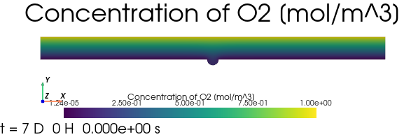
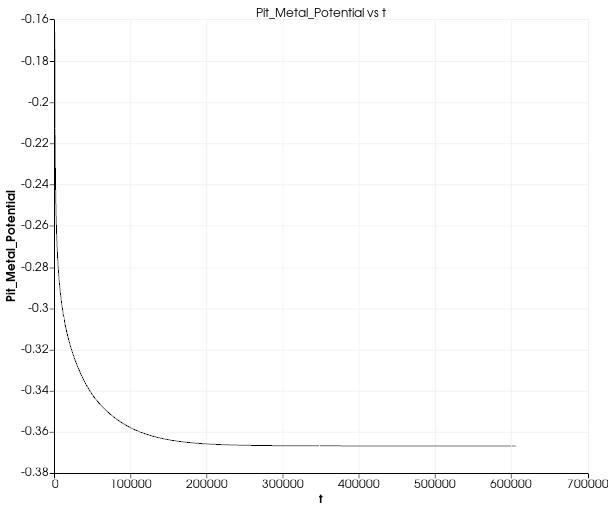
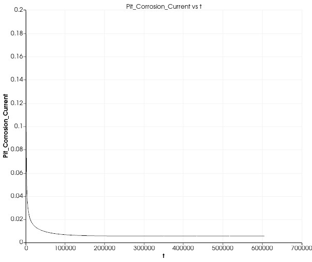

Corrosion Pit
=============

This example simulates the corrosion of a pit in a metal surface that is not
connected to an external current source. The electrons released by corrosion
in the pit can then only be consumed by cathodic reactions on the same metal,
here the reduction of oxygen on the surrounding surface. As a result, the
corrosion rate is not set by an imposed potential, but follows from the
balance between the anodic and the cathodic currents, with the metal
potential adjusting until both are equal :cite:p:`Hageman2023`. The set-up
follows the pencil-electrode case of :cite:t:`Hageman2023`.

Set-up
------

An electrolyte fills a rectangle of width :math:`W = 300\,\text{mm}` and
height :math:`20\,\text{mm}` above a metal surface, together with a
semicircular pit of radius :math:`5\,\text{mm}` in the middle of that surface
(mesh generator ``CorrosionPit``, :doc:`../../api/mesh_generators`; element
size :math:`2\,\text{mm}`, refined to :math:`0.25\,\text{mm}` along the
metal). The metal itself is not meshed: its surface is the boundary group
``metal``, split into the pit wall ``metal:pit`` and the flat outer surface
``metal:outer``.

* The electrolyte (``ElectroChemistry:Electrolyte``,
  :doc:`../../api/electrochemistry/electrolyte`) is a NaCl solution at pH 12
  with dissolved oxygen, described by the concentrations of Na\ :sup:`+`,
  Cl\ :sup:`-`, H\ :sup:`+`, OH\ :sup:`-`, Fe\ :sup:`2+`, FeOH\ :sup:`+` and
  O\ :sub:`2` and by the electrolyte potential. The species are transported
  by diffusion and migration (Nernst-Planck), the potential follows from
  electroneutrality, and the auto-ionization of water and the hydrolysis of
  Fe\ :sup:`2+` are included as volume reactions. The top boundary represents
  the bulk electrolyte and is held at its initial state
  (``ElectroChemistry:OpenBoundary``,
  :doc:`../../api/electrochemistry/open_boundary`).
* The pit wall and the outer surface each carry a
  ``ElectroChemistry:MetalElectrolyteInterface`` model
  (:doc:`../../api/electrochemistry/metal_electrolyte_interface`). Iron
  corrodes on the pit wall (Fe :math:`\to` Fe\ :sup:`2+` + 2e\ :sup:`-`),
  while oxygen is reduced on the outer surface; both surfaces also evolve
  hydrogen.
* The metal potential ``E_m`` is not imposed but solved for, as one global
  unknown shared by both surface models, from the condition that the net
  current over the whole metal surface vanishes
  (``"Metal_Potential": "Charge_Conservation"``).

The simulation covers seven days, starting with a time step of 300 s that
grows by 5 % per step up to one hour.

Options
-------

The script has no cases or script-specific options; it accepts the common
options ``--quick``, ``--no-plots`` and ``--output-dir`` (see :doc:`../index`).
``--quick`` uses a :math:`40\,\text{mm}` wide electrolyte, element sizes of
:math:`4\,\text{mm}` and :math:`1\,\text{mm}`, and ends after 1800 s.

Running
-------

.. code-block:: bash

   python examples/electrochemistry/corrosion_pit.py
   mpirun -n 4 python examples/electrochemistry/corrosion_pit.py

The figures of the fields, and of the metal potential and the surface
currents against time, are written to
``examples/electrochemistry/results/corrosion_pit/``, or to the folder given
by ``--output-dir``. Outside ``--quick`` runs, VTK files of the fields are
written every 10 steps to its ``data`` subfolder. At the end, the script
prints the metal potential and the corrosion, hydrogen and oxygen currents.

Sample output
-------------

The figures below are from the default run on four ranks (164 000 degrees
of freedom): 200 time steps without rejected steps, in 21 minutes::

   mpirun -n 4 python examples/electrochemistry/corrosion_pit.py

   Dissolved oxygen concentration after seven days.

   Metal potential (V\ :sub:`SHE`) against time (s).

   Corrosion current of the pit wall (A/m) against time (s).

Since the metal is isolated, the corrosion current of the pit has to match
the cathodic current, which is mostly the reduction of oxygen on the wide
outer surface. At first, oxygen is available everywhere along that surface,
so the metal potential rises and the pit corrodes fast. The iron dissolved at
the pit wall is converted into FeOH\ :sup:`+` by hydrolysis within the first
element layer along the wall, and the H\ :sup:`+` released by this hydrolysis
acidifies the pit to a pH of about 2 during the first hours. Oxygen is
supplied from the bulk electrolyte at the top boundary only; as it is used
up near the metal, its concentration decreases almost linearly towards the
outer surface, where it is nearly depleted, and the oxygen reduction becomes
limited by this diffusive supply. The cathodic current then decreases, and
the metal potential decreases until the corrosion current balances it
again. With the lower corrosion rate, the hydroxide produced by the oxygen
reduction around the pit neutralizes the acid produced in it, and the pit
returns to a pH above 11 within the first day. Once the oxygen profile is
stationary, the metal potential (:math:`-0.367\,\text{V}_\text{SHE}`) and
the corrosion current level off. At the end, the script prints equal corrosion and oxygen
currents (:math:`5.8 \times 10^{-3}\,\text{A/m}`), confirming the charge
balance, while the hydrogen currents are about ten orders of magnitude
smaller: the hydrogen evolution included here consumes H\ :sup:`+`, which is
scarce once the pit has returned to a pH near 12.

Where the pit acidifies, OH\ :sup:`-` falls by almost ten orders of
magnitude within seconds. The script therefore lists H\ :sup:`+` and
OH\ :sup:`-` in the solver option ``Positive_Fields``, so that their Newton
updates are taken in log space, and sets the ``Concentration_Floor`` of the
reaction rates far below the smallest OH\ :sup:`-` concentration. Without
these settings, a Newton update overshoots OH\ :sup:`-` below the floor,
where the rate of the water equilibrium no longer changes with it, and the
time step collapses to below :math:`10^{-3}\,\text{s}` once the pit
acidifies (see :doc:`../../api/electrochemistry/electrolyte`).

References
----------

.. bibliography::
   :filter: docname in docnames

Source code
-----------

.. literalinclude:: ../../../examples/electrochemistry/corrosion_pit.py
   :language: python
   :caption: examples/electrochemistry/corrosion_pit.py
