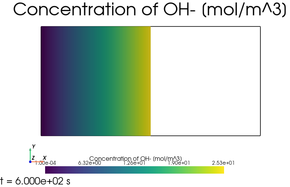
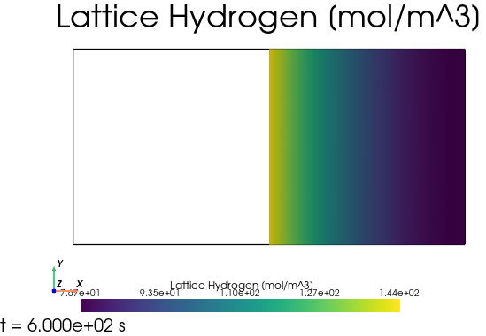

Electrolyte and Metal
=====================

This example couples an electrolyte to a loaded steel plate through the
hydrogen evolution reaction at their common surface. Part of the hydrogen
adsorbed on the metal surface during hydrogen evolution is absorbed into the
metal and diffuses into its lattice, so that the hydrogen uptake of the metal
depends on the surface reactions and on the composition of the electrolyte
next to the surface :cite:p:`Hageman2022a`. The example demonstrates three
features of FEMCubes: fields that exist on one subdomain only, a field that
lives on an interface, and fields of different subdomains that are solved
together in one step.

Set-up
------

Two adjacent :math:`1 \times 1\,\text{mm}` squares form one mesh (mesh
generator ``TwoSquared``, :doc:`../../api/mesh_generators`; element size
:math:`0.1\,\text{mm}`, refined to :math:`0.02\,\text{mm}` at the interface).

* ``domain:left`` is a NaCl electrolyte at pH 7
  (``ElectroChemistry:Electrolyte``, :doc:`../../api/electrochemistry/electrolyte`),
  described by the concentrations of Na\ :sup:`+`, Cl\ :sup:`-`,
  H\ :sup:`+` and OH\ :sup:`-` and the electrolyte potential, with
  Nernst-Planck transport, electroneutrality and the auto-ionization of
  water. The left boundary is held at the bulk state
  (``ElectroChemistry:OpenBoundary``,
  :doc:`../../api/electrochemistry/open_boundary`).
* ``domain:right`` is a steel plate: linear elastic
  (``Solid:LinearElastic``, :doc:`../../api/solids/linear_elastic`), fixed at
  the bottom and pulled at :math:`1\,\text{nm/s}` at the top
  (``Boundary:PrescribedValue`` and ``Boundary:DisplacementControl``), with
  diffusion of lattice hydrogen (``ElectroChemistry:HydrogenDiffusion``,
  :doc:`../../api/electrochemistry/hydrogen_diffusion`).
* The interface carries the hydrogen evolution reaction
  (``ElectroChemistry:MetalElectrolyteInterface``,
  :doc:`../../api/electrochemistry/metal_electrolyte_interface`): the Volmer
  and Heyrovsky steps in their acidic and alkaline forms, the Tafel step, and
  the absorption of hydrogen into the metal, at an imposed metal potential of
  :math:`-0.6\,\text{V}_\text{SHE}` and with reaction constants following
  :cite:t:`Hageman2023b`. The adsorbed hydrogen coverage ``theta_ads`` is a
  field on the interface only.

The concentrations, the electrolyte potential, the lattice hydrogen and the
coverage are solved together in the first step, and the displacements in the
second. The simulation covers 600 s in steps of 60 s.

Options
-------

``--no-interface`` leaves out the interface model, so that the electrolyte
and the metal are independent. The common options ``--quick``, ``--no-plots``
and ``--output-dir`` are described in :doc:`../index`; ``--quick`` uses a
coarser mesh and a 120-second run.

Running
-------

.. code-block:: bash

   python examples/electrochemistry/electrolyte_metal.py
   mpirun -n 2 python examples/electrochemistry/electrolyte_metal.py --no-interface

The figures are written to
``examples/electrochemistry/results/electrolyte_metal/``, or to the folder
given by ``--output-dir``. At the end, the script prints the force on the top
of the plate, the amount of lattice hydrogen in the metal and the average
surface coverage. Each case takes about 30 s on two ranks.

Sample output
-------------

The figures below show the default (coupled) case at
:math:`t = 600\,\text{s}`, run on two ranks (8 200 degrees of freedom, 30 s).

   OH\ :sup:`-` concentration in the electrolyte (left square).

   Lattice hydrogen concentration in the metal (right square).

Hydrogen evolution at the interface consumes H\ :sup:`+` and produces
OH\ :sup:`-`, so that the OH\ :sup:`-` concentration increases from its bulk
value at the left boundary towards the metal. Part of the adsorbed hydrogen
is absorbed into the metal and diffuses from the interface into the plate.
Without the interface model (``--no-interface``), the electrolyte remains at
its initial state and the metal takes up no hydrogen, with the script
printing a lattice hydrogen content of zero. The plate is only loaded
elastically, and its force-displacement curve, also saved by the script, is
linear. The mechanical and the hydrogen problems are not coupled: the elastic
model does not depend on the hydrogen concentration, and
``ElectroChemistry:HydrogenDiffusion`` includes neither trapping nor
stress-driven diffusion.

References
----------

.. bibliography::
   :filter: docname in docnames

Source code
-----------

.. literalinclude:: ../../../examples/electrochemistry/electrolyte_metal.py
   :language: python
   :caption: examples/electrochemistry/electrolyte_metal.py
