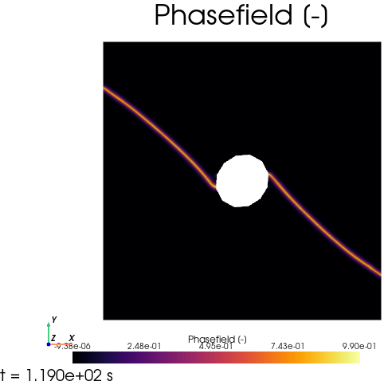
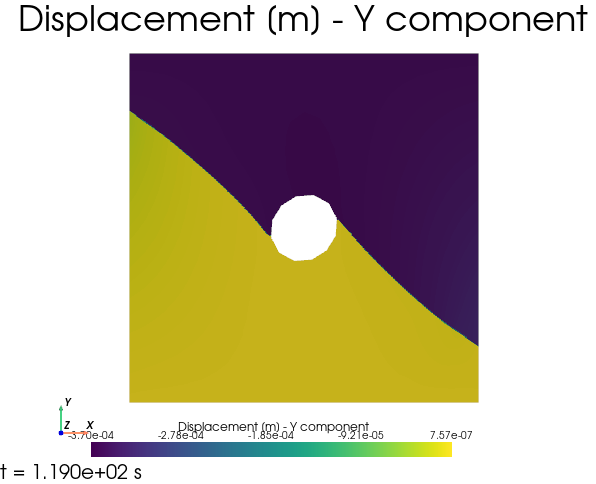
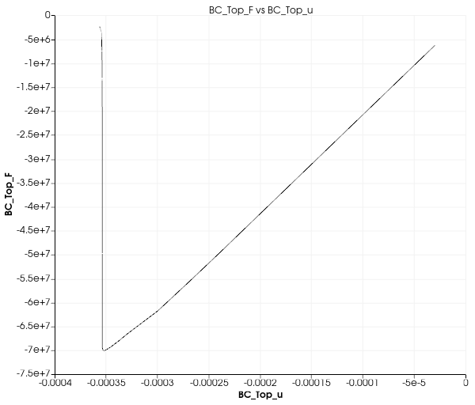
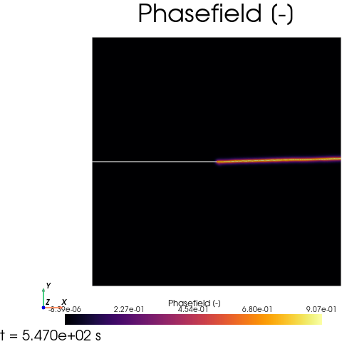
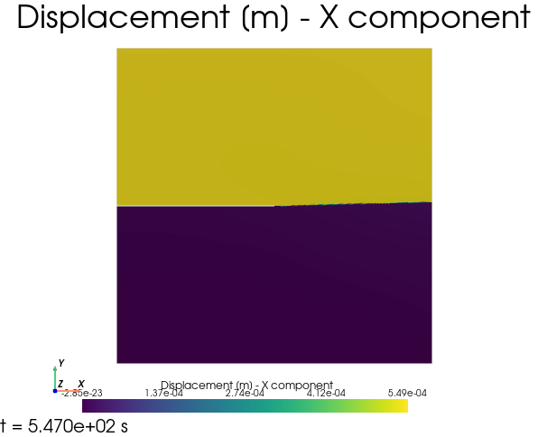
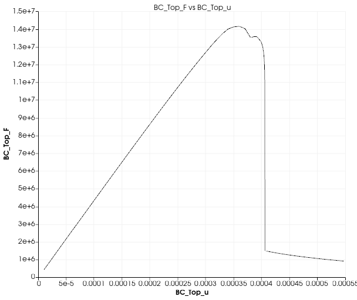
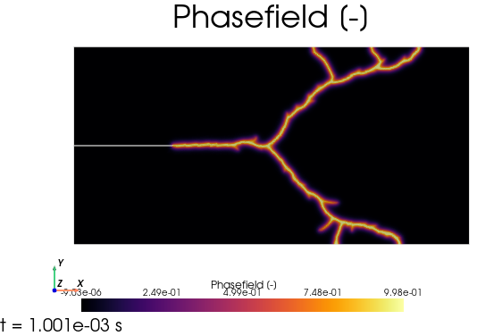
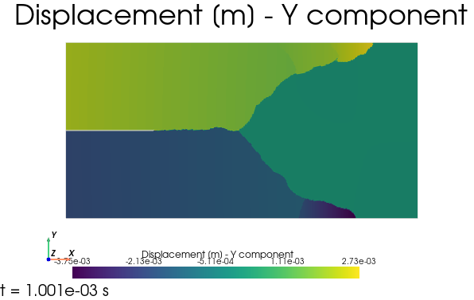
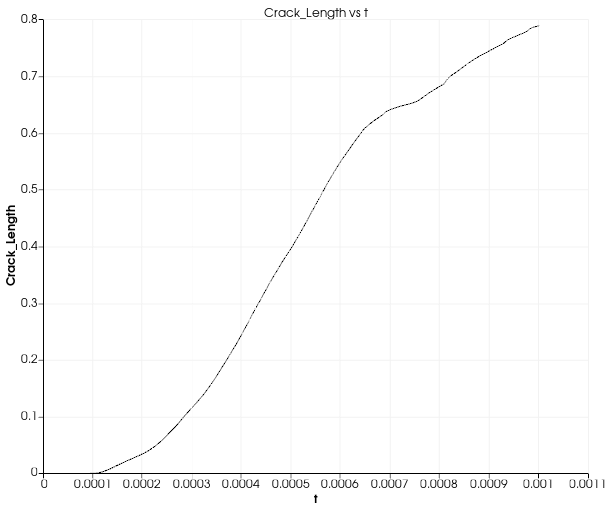

Cohesive Phase-Field Fracture
=============================

This example applies the strength-based cohesive phase-field model to steel
plates, on three benchmark geometries of :cite:t:`Hageman2026b`: a plate with
a hole under compression, a notched plate in shear, and a notched plate under
a sudden tensile load that makes the crack branch. In this model, cracks open
through fracture eigenstrains that develop once the stress reaches an
explicit strength surface :cite:p:`Vicentini2026`, and the phase field
degrades the strength rather than the stiffness. Crack nucleation is
therefore governed by the strength surface and crack growth by the fracture
energy, both independent of the phase-field length scale
:cite:p:`Hageman2026b`.

Set-up
------

All cases combine the cohesive solid model ``Solid:Cohesive_LinearElastic``
(:doc:`../../api/solids/cohesive_linear_elastic`, the cohesive solid of
:doc:`../../api/solids/cohesive_viscoelastic` without creep) with the
phase-field model ``Solid:PhaseField`` (:doc:`../../api/solids/phase_field`;
HO-AT2, length scale :math:`\ell = 10\,\text{mm}`, driven by the cohesive
energy ``PsiField``). The material is steel (:math:`E = 200\,\text{GPa}`,
:math:`\nu = 0.3`, tensile and shear strength :math:`150\,\text{MPa}`), with
inertia and a damping coefficient of
:math:`8 \times 10^9\,\text{Pa}\,\text{s/m}^2`. The mesh is refined
adaptively to :math:`\ell/2` wherever the cohesive strain (``etaNorm``) is
non-zero, and the time step is reduced so that the crack grows by at most
:math:`\ell` per step (:math:`0.1\,\ell` for ``dynamic``).

``full_plate``
   A :math:`1 \times 1\,\text{m}` plate with a central elliptical hole
   (radius :math:`0.1\,\text{m}`, ellipticity 1.1, rotated by 45°; mesh
   generator ``FullPlateWithHole``), fixed at the bottom and compressed from
   the top at :math:`3\,\mu\text{m/s}` (``Boundary:DisplacementControl``,
   :doc:`../../api/boundary/displacement_control`).
``single_edge_notched``
   A :math:`1 \times 1\,\text{m}` plate with a horizontal notch of
   :math:`0.5\,\text{m}` (mesh generator ``SingleEdgeNotched``), fixed at the
   bottom; the top is moved horizontally at :math:`1\,\mu\text{m/s}` with its
   vertical displacement held at zero.
``dynamic``
   A :math:`1 \times 0.5\,\text{m}` plate with a :math:`0.25\,\text{m}` notch,
   loaded by a traction of :math:`10\,\text{MPa}` applied at once on the top
   and bottom edges (``Boundary:ExternalForce``,
   :doc:`../../api/boundary/external_force`), without damping and with a
   fracture energy of :math:`1\,\text{kJ/m}^2` instead of
   :math:`10\,\text{kJ/m}^2`; the strength-surface settings also differ
   (see the source below).

The two displacement-controlled cases stop once the force has dropped below
10 % of its peak. The mesh generators are described in
:doc:`../../api/mesh_generators`.

Options
-------

``--case`` selects ``full_plate`` (default), ``single_edge_notched`` or
``dynamic``. The common options ``--quick``, ``--no-plots`` and
``--output-dir`` are described in :doc:`../index`; ``--quick`` doubles the
element size and runs five time steps.

Running
-------

.. code-block:: bash

   python examples/fracture/cohesive_phasefield.py --case full_plate
   mpirun -n 8 python examples/fracture/cohesive_phasefield.py --case dynamic

The figures (PNG), movies (MP4) of the fields, and animations of each mesh
refinement are written to
``examples/fracture/results/cohesive_phasefield/<case>/``, or to the folder
given by ``--output-dir``.

Run times with the default settings and all plots and movies:

.. list-table::
   :header-rows: 1

   * - Case
     - Ranks
     - Run time
     - Cells (initial / final)
     - End of the run
   * - ``full_plate``
     - 8
     - 15 min
     - 944 / 19 300
     - force drop, :math:`t = 119\,\text{s}`
   * - ``single_edge_notched``
     - 4
     - 9 min
     - 1 190 / 9 530
     - force drop, :math:`t = 547\,\text{s}`
   * - ``dynamic``
     - 8
     - 36 min
     - 2 180 / 23 400
     - end time :math:`t = 10^{-3}\,\text{s}`, 1 105 steps

Most of the time is spent while the cracks grow, as the time step is then
reduced to keep the crack growth per step below its limit, and the mesh is
refined after almost every step.

Sample output
-------------

Full plate with hole
^^^^^^^^^^^^^^^^^^^^

   Phase field at the end of the simulation.

   Vertical displacement at the end of the simulation.

   Force on the top edge (N/m) against its displacement (m), both negative
   in compression.

The stress concentrations at the sides of the hole make the cracks start
there, and under compression they follow the direction of the largest shear
stress, at roughly 45°, to the plate edges :cite:p:`Hageman2026b`: the
strength surface limits the deviatoric stress through the shear strength,
while its compressive branch keeps the crack faces from interpenetrating.
The part of the plate above the cracks, which carries the loaded top edge,
then slides
down along them, as the jump in the vertical displacement shows. The force
grows linearly until the cracks start, and then drops at an almost constant
displacement.

Single-edge-notched plate in shear
^^^^^^^^^^^^^^^^^^^^^^^^^^^^^^^^^^

   Phase field at the end of the simulation.

   Horizontal displacement at the end of the simulation.

   Horizontal force on the top edge (N/m) against its horizontal displacement
   (m).

The crack grows from the notch tip almost horizontally towards the right
edge, rising only slightly, which shows that it is driven by shear rather
than by tension; a tensile crack would run downwards at about 45°
:cite:p:`Hageman2026b`. Once the crack has run through, the upper half of
the plate slides over the lower half. The force reaches its peak, decreases
slowly while the crack starts to grow, and drops once the crack has crossed
the plate.

Dynamic crack branching
^^^^^^^^^^^^^^^^^^^^^^^

   Phase field at the end of the simulation.

   Vertical displacement at the end of the simulation.

   Crack length (m) against time (s).

The crack grows straight from the notch tip and branches near the middle of
the plate into two arms, which curve towards the top and bottom edges. This
branching follows from the dynamic energy balance: a branched crack creates
more crack length per unit time than a single crack, and with the low
fracture energy of this case the cost of the additional crack surface is
small compared to the elastic and kinetic energy released by the fast
crack, so that branching acts as an additional dissipation mechanism
:cite:p:`Hageman2026b`. The crack length rises at an almost constant rate
while the arms grow, and stalls once they reach the edges. Each arm then
forks again: a new branch grows from it to the nearest loaded edge and cuts
off a small piece of the plate, which moves fastest in the vertical
displacement. Throughout, the cracked material keeps its full density, as
the phase field degrades only the strength of the cohesive model.

References
----------

.. bibliography::
   :filter: docname in docnames

Source code
-----------

.. literalinclude:: ../../../examples/fracture/cohesive_phasefield.py
   :language: python
   :caption: examples/fracture/cohesive_phasefield.py
