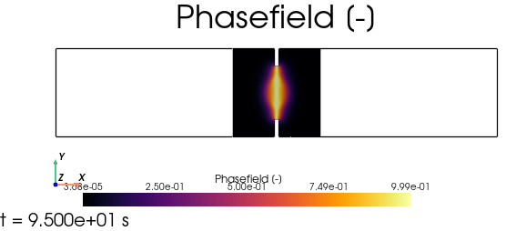
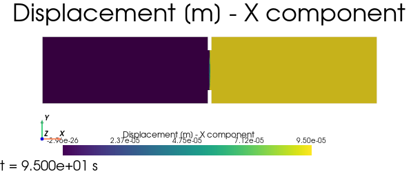
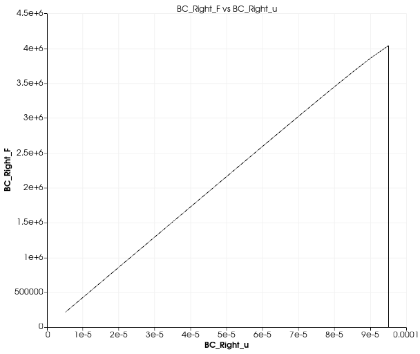

Multi-Domain Tensile Bar
========================

This example pulls apart a double-edge-notched steel bar, with the phase field
solved only in the notched centre of the bar. Restricting the fracture model
to the region where the crack is expected limits the phase-field degrees of
freedom to that region, and allows the fine mesh needed to resolve the phase
field to be used there only. The example shows how models are restricted to
named subdomains.

Set-up
------

The bar is :math:`100 \times 20\,\text{mm}`, with a notch of
:math:`1\,\text{mm}` width and :math:`4\,\text{mm}` depth in the middle of the
top and bottom edges (plane strain). The ``NotchedTensileBar`` mesh generator
(:doc:`../../api/mesh_generators`) splits it into three conforming subdomains:
``domain:left`` and ``domain:right`` (element size :math:`2\,\text{mm}`) and
the :math:`20\,\text{mm}` wide ``domain:centre`` around the notches (element
size :math:`0.25\,\text{mm}`).

* All three subdomains are linear elastic
  (``Solid:LinearElastic``, :doc:`../../api/solids/linear_elastic`); in
  ``domain:centre`` the stiffness is degraded by the phase field.
* The phase field (``Solid:PhaseField``, :doc:`../../api/solids/phase_field`;
  AT2, :math:`\ell = 1\,\text{mm}`) acts on ``domain:centre`` only, so it has
  degrees of freedom only there. It is driven by the stress-based crack
  driving force of the solid :cite:p:`Miehe2015a`, the default
  ``CrackDrivingForce``: the solid converts the stress into an energy-like
  quantity and writes it to the field ``ElasticEnergy``, so that only the
  stress, and no plastic or creep deformation, drives the crack. Irreversibility is enforced through a history field
  :cite:p:`Miehe2010a`, and :math:`G_c` is obtained from the tensile strength
  :math:`f_t = 500\,\text{MPa}` with
  :func:`~femcubes.core.utils.maths_utils.ft_to_Gc`.
* The left end is clamped (``Boundary:PrescribedValue``,
  :doc:`../../api/boundary/prescribed_value`), and the right end is pulled at
  :math:`1\,\mu\text{m/s}` (``Boundary:DisplacementControl``,
  :doc:`../../api/boundary/displacement_control`), which records the end
  displacement ``BC_Right_u`` and force ``BC_Right_F``.

The time step is halved whenever the crack length increases by more than
:math:`\ell` within one step, and the simulation ends 50 steps after the force
has dropped below 5 % of its peak.

Every model names the subdomain it acts on in its ``"domain"`` entry.
Boundary names follow the same ``<boundary>:<subdomain>`` scheme: ``top``
covers ``top:left``, ``top:centre`` and ``top:right``.

Options
-------

The script has no cases or script-specific options; it accepts the common
options ``--quick``, ``--no-plots`` and ``--output-dir`` (see
:doc:`../index`). ``--quick`` uses a coarser mesh, a lower strength and a
15-second run.

Running
-------

.. code-block:: bash

   python examples/fracture/multidomain_tensile_bar.py
   mpirun -n 4 python examples/fracture/multidomain_tensile_bar.py

The figures (PNG) and movies (MP4) of the phase field and the horizontal
displacement are written to
``examples/fracture/results/multidomain_tensile_bar/``, or to the folder
given by ``--output-dir``. The default case takes about two minutes on four
ranks.

Sample output
-------------

The figures below are from the default case on four ranks (16 600 cells,
97 000 degrees of freedom, 110 s); the simulation ended at
:math:`t = 95\,\text{s}`. In the phase-field figure, the outer subdomains are
drawn without colour, since the phase field does not exist there.

   Phase field at the end of the simulation.

   Horizontal displacement at the end of the simulation.

   Force (N/m) against the displacement of the right end (m).

The force increases linearly up to the peak, at which a crack forms between
the two notch tips, and then drops to zero at an almost constant end
displacement. This vertical drop shows that the crack grows unstably: once it
has formed, the elastic energy released by the unloading bar suffices to
propagate it through the ligament, without a further increase of the imposed
displacement. The response would show snap-back, which displacement control
cannot follow (FEMCubes has no arc-length control); the unstable growth is
instead resolved in time, which also leaves a rather wide phase-field band.
As the time step is halved whenever the crack grows by more than
:math:`\ell` in one step, this growth is spread over several steps.
After fracture, both halves are unloaded: the left half is at rest, the right
half follows the imposed end displacement, and the horizontal displacement
jumps across the crack.

References
----------

.. bibliography::
   :filter: docname in docnames

Source code
-----------

.. literalinclude:: ../../../examples/fracture/multidomain_tensile_bar.py
   :language: python
   :caption: examples/fracture/multidomain_tensile_bar.py
