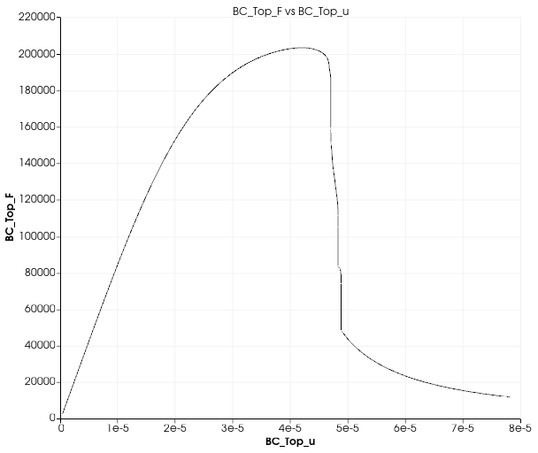
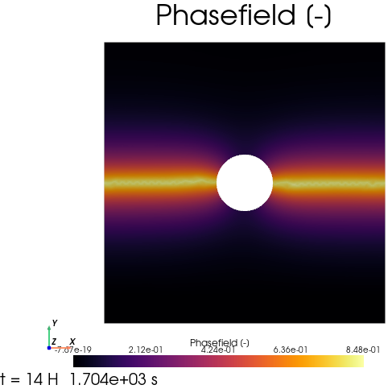
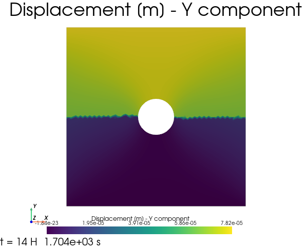

Creep and Fracture of an Ice Plate with a Hole
==============================================

This example pulls an ice plate with a central hole at a constant strain
rate, such that creep and cohesive fracture compete. Ice creeps under
sustained stress following Glen's flow law :cite:p:`Glen1955`, which relaxes
the stress concentrations at the hole, while the cohesive phase-field model
opens cracks once the stress reaches the strength surface. Which of the two
dominates depends on the loading rate and the fracture energy. This is the
plate-with-hole benchmark of :cite:t:`Hageman2026CMAME` (see
:doc:`../../publications`), at the largest phase-field length scale of its
length-scale study, so that it runs in about a quarter of an hour.

Set-up
------

A :math:`1 \times 1\,\text{m}` plate with a central hole of radius
:math:`R = 0.1\,\text{m}` (mesh generator ``FullPlateWithHole``,
:doc:`../../api/mesh_generators/full_plate_with_hole`). The bottom edge is
clamped (``Boundary:PrescribedValue``,
:doc:`../../api/boundary/prescribed_value`); the top edge is free to move
sideways and is pulled up at :math:`\dot\varepsilon L_y`
(``Boundary:DisplacementControl``,
:doc:`../../api/boundary/displacement_control`), with a nominal strain rate
:math:`\dot\varepsilon = 1.5 \times 10^{-9}\,\text{s}^{-1}`. The phase field
is held at zero in a :math:`0.1\,\text{m}` strip along the clamped edge
(``Solid:No_PhaseField``, :doc:`../../api/solids/no_phase_field`).

* The ice is modelled by ``Solid:Cohesive_ViscoElastic``
  (:doc:`../../api/solids/cohesive_viscoelastic`) as an intrinsic 2-D material
  (``true_2d``): elastic (:math:`E = 9.5\,\text{GPa}`, :math:`\nu = 0.35`),
  Glen creep (:math:`n = 3`,
  :math:`A = 10^{-24}\,\text{Pa}^{-3}\text{s}^{-1}`), and the ``r2_2L``
  strength surface (tensile strength :math:`0.4\,\text{MPa}`, shear strength
  :math:`0.6\,\text{MPa}`), with inertia and a damping coefficient of
  :math:`10^9\,\text{Pa}\,\text{s/m}^2` that keeps the crack growth quasi-static.
* The phase field ``Solid:PhaseField`` (:doc:`../../api/solids/phase_field`)
  uses AT2 with :math:`G_c = 5\,\text{J/m}^2`, :math:`\ell = 0.1\,\text{m}`
  and a history field, and corrects :math:`G_c` for the element size along
  the crack (``Gc_Mesh_Correction``, :math:`G_c / (1 + 0.33\,h/\ell)`), the
  first-order element-size error of cohesive phase-field models
  :cite:p:`Feng2026AMR`.
* The background element size is :math:`0.03\,\text{m}`, with elements of
  :math:`\min(0.01\,\text{m}, \ell/4)` within :math:`0.025\,\text{m}` of the
  hole. Cells with cohesive strain (``etaNorm``) and six layers around them
  are refined to :math:`\ell/4`, one level per time step.
* Time steps are :math:`200\,\text{s}` (a strain increment of
  :math:`3 \times 10^{-7}`), shortened so that the crack length grows by at
  most :math:`2.5\,\text{mm}` per step. The simulation ends at a top
  displacement of :math:`0.1\,\text{mm}`, or 50 steps after the force on the
  top edge has dropped below 10 % of its peak.

These are the settings of the paper, except for the element size at the
hole, which the paper sets to :math:`2\,\text{mm}`. With that mesh the run
takes twice as long and gives the same curve as the paper; the
:math:`10\,\text{mm}` elements give the same peak load and a load drop
delayed by about 1 % of the displacement.

The script also saves the strength surface of the ice
(``failure_surface.png``).

Options
-------

``--rate`` selects the strain rate of the paper: ``low``
(:math:`1.0 \times 10^{-9}\,\text{s}^{-1}`), ``medium`` (default,
:math:`1.5 \times 10^{-9}\,\text{s}^{-1}`) or ``high``
(:math:`2.5 \times 10^{-9}\,\text{s}^{-1}`). ``--gc`` sets the fracture
energy in :math:`\text{J/m}^2` (default 5; the paper uses 1, 2.5, 5 and 10,
and for :math:`G_c \geq 10` the run continues to a displacement of
:math:`0.35\,\text{mm}`). ``--ell`` sets the phase-field length scale in m
(default 0.1; the paper uses 0.005 to 0.1), which also sets the refined
element size. The common options ``--quick``, ``--no-plots`` and
``--output-dir`` are described in :doc:`../index`; ``--quick`` uses coarser
elements (:math:`0.1\,\text{m}`, :math:`0.02\,\text{m}` at the hole) and runs
five time steps.

Running
-------

.. code-block:: bash

   mpirun -n 8 python examples/fracture/viscoelastic_fracture.py
   mpirun -n 8 python examples/fracture/viscoelastic_fracture.py --rate high --gc 10

The figures (PNG) and movies (MP4) of the phase field, the vertical
displacement and the vertical stress, the force-displacement curve and the
crack length are written to
``examples/fracture/results/viscoelastic_fracture/``, or to the folder given
by ``--output-dir``; the history of all global measures is written to
``Data/time_data.hdf5`` in the same folder.

On 8 ranks, the default run takes 15 min with all plots and movies, and
10 min with ``--no-plots``; ``--quick`` takes about a minute on 2 ranks, most
of which is spent compiling the forms. Most of the run time is spent while
the cracks grow, as the time step then falls to fractions of a second and
the staggered solver needs up to its ten passes per step.

Sample output
-------------

The figures below are from the default run on 8 ranks. Adaptive refinement
increases the mesh from 3 100 to 6 960 cells, and the simulation ends after
585 steps, at a top displacement of :math:`0.078\,\text{mm}`.

   Force on the top edge (N/m) against its displacement (m).

   Phase field at the end of the simulation.

   Vertical displacement at the end of the simulation.

The force, which equals the mean vertical stress in Pa for the
:math:`1\,\text{m}` wide plate, first rises almost linearly and then bends
over as creep relaxes the stress concentration at the hole. Up to the first
cohesive strain, the response is governed by elasticity and creep alone;
from then on, creep in the bulk and the loss of cohesion at the crack
compete to dissipate the work of the imposed displacement
:cite:p:`Hageman2026CMAME`. The peak, at :math:`0.203\,\text{MPa}`, is
reached while the cohesive strain develops, before the phase field has
grown. Two horizontal cracks then run from the sides of the hole, where the
stresses are highest, to the plate edges, and the force drops steeply in a
few stages as they advance. Behind the crack tips the phase field stays
below one, as it describes the gradual loss of cohesion rather than a
traction-free crack. The cracks therefore still transmit cohesive tractions,
and the force decays slowly once the plate is cut through. The curve matches
the paper's run at this length scale; in the paper, smaller length scales,
which cost more, give a peak a few percent lower and an earlier, shorter load
drop.

References
----------

.. bibliography::
   :filter: docname in docnames

Source code
-----------

.. literalinclude:: ../../../examples/fracture/viscoelastic_fracture.py
   :language: python
   :caption: examples/fracture/viscoelastic_fracture.py
