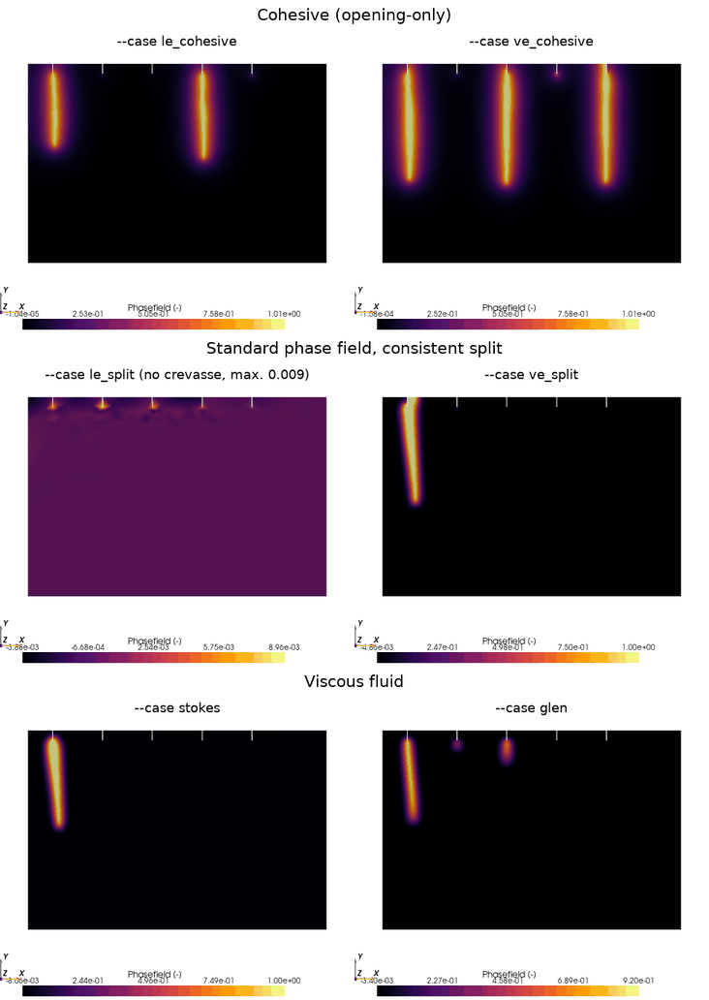
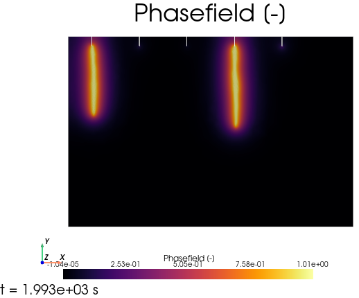
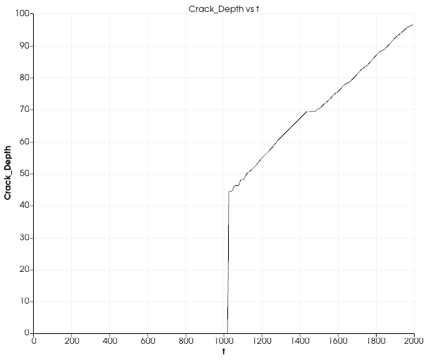
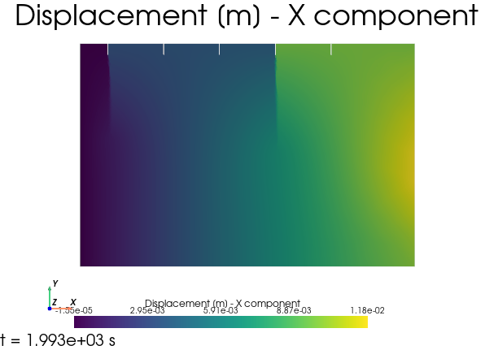
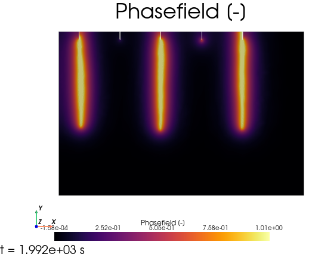
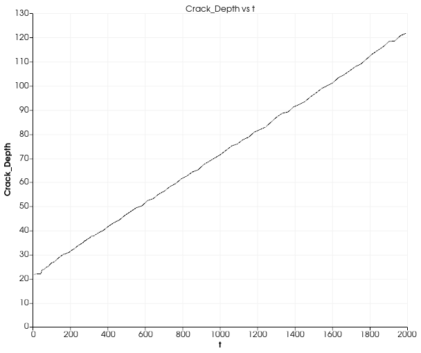

Ice Cliffs
==========

.. warning::

   This is a slow example. The default case takes about 12 minutes on 8 MPI
   ranks; the viscoelastic cohesive case ``ve_cohesive`` takes about
   35 minutes, and several hours with ``--water-end 0`` (the full lowering of
   the paper). Run it with MPI, not in serial.

This example simulates the growth of crevasses at a grounded ice cliff as the
water in front of it is lowered, with a choice of six rheologies. Lowering
the water removes the support of the cliff face and brings the upper part of
the cliff into horizontal tension, so that crevasses grow from the surface
:cite:p:`Hageman2026CMAME`. The set-up is a smaller version of the ice-cliff
case of :cite:t:`Hageman2026CMAME` (Section 4.2; see
:doc:`../../publications`): the same ice, strength surface, loading and
numerics, on a shorter cliff and with a larger phase-field length scale.
Comparing the rheologies shows how the fracture model and creep determine
where crevasses form and how deep they grow.

Set-up
------

A :math:`300 \times 200\,\text{m}` grounded ice cliff (mesh generator
``Rectangle_Notches``, :doc:`../../api/mesh_generators`; background element
size :math:`25\,\text{m}`, refined adaptively to :math:`\ell/4` where the
cohesive strain or the phase field is non-zero). Five surface notches,
:math:`0.5\,\text{m}` wide and :math:`10\,\text{m}` deep, stand for
pre-existing crevasses; they are :math:`50\,\text{m}` apart, the first
:math:`25\,\text{m}` from the left edge.

* Gravity acts in full from the start. The left edge is on rollers, so it acts
  as a symmetry plane; the bed is free-slip (``--base``, see below).
* The water against the cliff face (right edge) is
  ``glaciology:LoweringOceanPressure``
  (:doc:`../../api/glaciology/lowering_ocean_pressure`). During a 100-hour
  spin-up with hourly steps it stands at flotation, :math:`177.6\,\text{m}`,
  so the ice is in the state of a buttressed cliff, with or without creep.
  Without creep, the ice is laterally confined under its own weight; with
  creep, the deviatoric stresses relax during the spin-up and the stress
  approaches a lithostatic state, which leaves the surface under a larger
  tension for the same water level :cite:p:`Hageman2026CMAME`. From
  :math:`t = 0` the water is lowered at the rate of the paper (from flotation
  to zero in one hour) down to ``--water-end``, :math:`80\,\text{m}` by
  default, which ends the run at :math:`t = 1910\,\text{s}`.
* Time steps of at most :math:`30\,\text{s}` (:math:`1\,\text{s}` in the first
  10 s), reduced so that the cracks grow by at most :math:`2\ell` per step.
  The crack depth is recorded by ``Solid:CrackDepthMeasure``
  (:doc:`../../api/solids/crack_depth_measure`).

The rheology is selected with ``--case``; each solid model is combined with
the phase-field model ``Solid:PhaseField`` (:doc:`../../api/solids/phase_field`):

``le_cohesive`` (default) / ``ve_cohesive``
   the cohesive phase-field model of the paper without and with Glen creep
   (``Solid:Cohesive_LinearElastic``,
   :doc:`../../api/solids/cohesive_linear_elastic`, and
   ``Solid:Cohesive_ViscoElastic``, :doc:`../../api/solids/cohesive_viscoelastic`)
   with the opening-only strength surface ``r2_2L_PSD``
   (:math:`f_t = 0.4\,\text{MPa}`, :math:`f_s = 1.5\,\text{MPa}`,
   :math:`G_c = 10\,\text{J/m}^2`), AT2 with a linear phase field, history
   irreversibility and the mesh correction of :math:`G_c`. With the
   opening-only surface, ice that has lost its cohesion beside a crevasse
   still carries the weight of the ice above it;
``le_split`` / ``ve_split``
   standard phase-field fracture (HO-AT1, ``NoTension`` split, fracture energy
   set from the tensile strength) of an elastic or viscoelastic solid, with the
   stress split in the same way as the driving force, a consistent split (see
   :ref:`solids-split-consistency`; ``Solid:SplitLinearElastic``,
   :doc:`../../api/solids/split_linear_elastic`, and ``Solid:SplitViscoElastic``,
   :doc:`../../api/solids/split_viscoelastic`);
   for ``ve_split`` the example sets ``"CreepCoupling": "PartialExplicit"``
   (the model's default is ``EffectiveStress``; the options are described on
   its API page);
``stokes`` / ``glen``
   a viscous fluid with Newtonian or Glen viscosity (``Solid:Stokes``,
   :doc:`../../api/solids/stokes`) with phase-field damage and a stress-based
   driving force; the unknown is the velocity instead of the displacement.

The bed is set with ``--base``:

``free_slip`` (default, as in the paper)
   only the vertical bed displacement fixed;
``frozen``
   no slip: both bed displacements (or velocities) fixed;
``floating``
   ocean pressure on the bed instead of a support;
``friction``
   linear basal friction (``glaciology:BasalFriction``,
   :doc:`../../api/glaciology/basal_friction`) with coefficient ``--friction``.

The pressure and friction on the bed are reduced with the phase field
(``DamagedForces``) only for the standard phase-field cases. The cohesive
cases need no reduction: the damaged ice keeps carrying compression, so it
also carries the water pressure and the friction, as it carries its own
weight.

All cases use Newton's method for both steps, with up to ten staggered passes
per time step (see :doc:`../../api/core/solvers/nonlinear`).

Options
-------

``--case`` (default ``le_cohesive``), ``--water-end`` (water level at the end
of the lowering in m, default 80; 0 gives the full lowering of the paper),
``--ell`` (phase-field length scale in m, default 10; the paper used 1 to 4),
``--base`` (default ``free_slip``), ``--friction`` (linear friction
coefficient in Pa/(m/s), default 0, used with ``--base friction``). The common
options ``--quick``, ``--no-plots`` and ``--output-dir`` are described in
:doc:`../index`; ``--quick`` runs a 2-hour spin-up and stops just after
:math:`t = 0`.

Running
-------

.. code-block:: bash

   mpirun -n 8 python examples/glaciology/ice_cliffs.py
   mpirun -n 8 python examples/glaciology/ice_cliffs.py --case ve_cohesive --water-end 0

The figures and movies of the phase field and the displacement (or velocity)
components, the crack depth against time, and for the cohesive cases the
strength surface (``failure_surface.png``, drawn on one rank before the run
starts, about 2 minutes) are written to
``examples/glaciology/results/ice_cliffs/<case>/``, or to the folder given by
``--output-dir``.

Run times with the default settings (lowering to 80 m) on 8 ranks, with all
plots and movies:

.. list-table::
   :header-rows: 1

   * - Case
     - Run time
     - Result at 80 m water
   * - ``le_cohesive``
     - 12 min
     - two straight crevasses, 97 m deep
   * - ``ve_cohesive``
     - 35 min
     - three straight crevasses, 122 m deep
   * - ``le_split``
     - 2 min
     - no crevasse
   * - ``ve_split``
     - 29 min
     - one crevasse
   * - ``stokes``
     - 7 min
     - one crevasse
   * - ``glen``
     - 33 min
     - one crevasse and damage at two further notches

Comparison of the cases
-----------------------

   Phase field at the end of each case with the default settings (water at
   80 m): rows are the model families, columns elastic (left) and viscous
   (right); each panel has its own colour scale.

Only the cohesive model forms crevasses at several notches with the elastic
response. Its strength surface is evaluated at each integration point,
independent of the phase-field length scale :cite:p:`Hageman2026b`, so the
stress at the notch tips reaches it as the water drops. The standard model
needs a region about :math:`\ell` wide to reach its strength; with
:math:`\ell = 10\,\text{m}` and :math:`0.5\,\text{m}` notches, the elastic
case (``le_split``) does not crack before the water reaches 80 m, and the
viscous cases form a single crevasse, at the notch furthest from the face.

Sample output
-------------

The figures below are from the default ``le_cohesive`` case on 8 ranks;
adaptive refinement increases the mesh from 633 to 8 850 cells over the
228 time steps.

   Phase field at the end of the simulation, with the water at 80 m.

   Depth of the deepest crevasse (m) against time (s).

   Horizontal displacement (m) at the end of the simulation.

Without creep, the laterally confined ice develops no crevasse until the
water has dropped to about :math:`127\,\text{m}`
(:math:`t \approx 1000\,\text{s}`). The first crevasse then grows unstably to
about :math:`45\,\text{m}`: the :math:`0.5\,\text{m}` notch is narrower than
:math:`\ell` and thus not resolved by the phase field, which delays the
start of the growth, as in the length-scale study of the paper. From there
on, both crevasses deepen steadily as the water drops. The open crevasses
split the cliff into blocks that move towards the face. With the full
lowering, the elastic crevasses reach about :math:`186\,\text{m}`, close to
the :math:`184\,\text{m}` of the paper at :math:`\ell = 1` to
:math:`4\,\text{m}`.

The figures below are from ``ve_cohesive`` with the default settings on 8
ranks; the mesh increases from 633 to 14 800 cells over 249 time steps.

   Phase field of ``ve_cohesive`` at the end of the simulation, with the
   water at 80 m.

   Depth of the deepest crevasse (m) against time (s) for ``ve_cohesive``.

With creep, the surface near the notches is already close to the strength
surface at :math:`t = 0`, as the ice has relaxed towards the lithostatic
state during the spin-up, so that crevasses start as soon as the water
begins to drop. The crevasses that start first relieve the tension at the
neighbouring notches before these crack, and only every second notch
develops into a crevasse, as in the paper for its larger length scales
:cite:p:`Hageman2026CMAME`. The crevasses are deeper than the elastic ones at
the same water level, as in the paper.

References
----------

.. bibliography::
   :filter: docname in docnames

Source code
-----------

.. literalinclude:: ../../../examples/glaciology/ice_cliffs.py
   :language: python
   :caption: examples/glaciology/ice_cliffs.py
