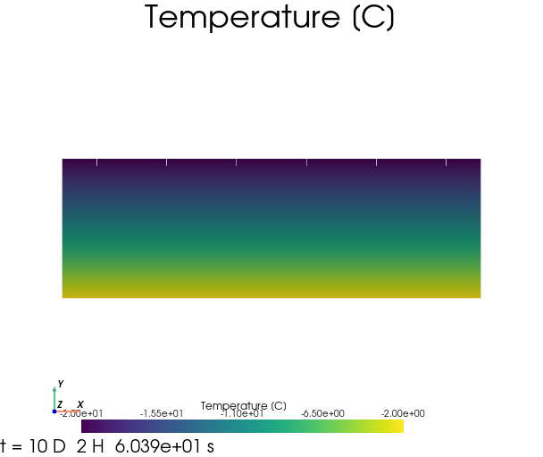
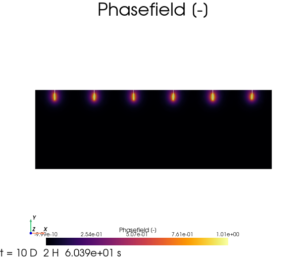
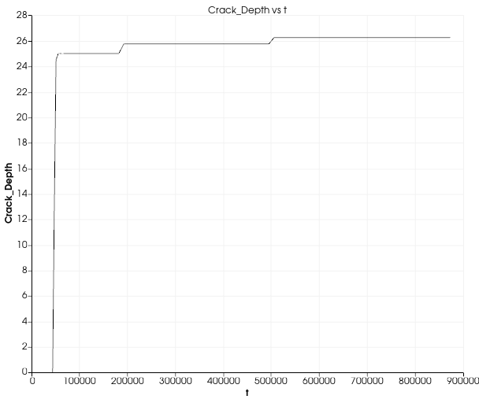
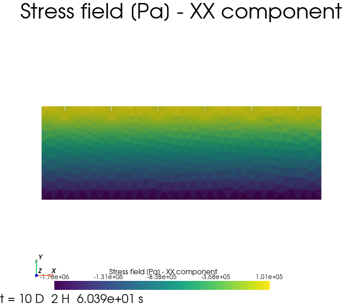

Ice Shelf Front
===============

This example simulates surface crevasses near the front of a floating ice
shelf whose temperature varies through its thickness. The creep rate of ice
depends strongly on temperature :cite:p:`Paterson1982,CuffeyPaterson2010`:
near the melting point it creeps about twenty times faster than at
:math:`-20\,^\circ\text{C}`. A temperature profile therefore changes how
the stress is distributed through the shelf, and so how deep crevasses
grow. The example compares a shelf with a cold surface and a warm base
against a shelf at uniform temperature, using the ice version of the
cohesive phase-field model of :cite:t:`Hageman2026CMAME`.

Set-up
------

A :math:`600 \times 200\,\text{m}` section of a floating ice shelf, from an
inland symmetry plane (left, held horizontally) to the ice front (right)
(mesh generator ``Rectangle_Notches``, :doc:`../../api/mesh_generators`;
background element size :math:`25\,\text{m}`, refined adaptively to
:math:`\ell/4` where the cohesive strain is non-zero). Six surface notches,
:math:`0.5\,\text{m}` wide and :math:`10\,\text{m}` deep and
:math:`100\,\text{m}` apart, stand for pre-existing crevasses.

* Gravity and the hydrostatic ocean pressure (``glaciology:OceanPressure``,
  :doc:`../../api/glaciology/ocean_pressure`) on the front and the base act
  from :math:`t = 0`. The sea level is at the flotation height
  :math:`\rho_i H/\rho_w = 179\,\text{m}`. The pressure on the base follows
  the current height of the base, so it also holds the shelf vertically.
  It is not reduced with the phase field, as the cohesive model keeps
  carrying compression in failed ice.
* The crevasses are dry: no water pressure acts on the crack faces. Basal
  crevasses, which would be filled with sea water, are therefore not
  represented.
* The ice is ``Glaciology:Cohesive_ViscoElastic``
  (:doc:`../../api/glaciology/ice_cohesive_viscoelastic`) with the
  opening-only strength surface ``r2_2L_PSD``, and
  ``Glaciology:PhaseField``
  (:doc:`../../api/glaciology/ice_phasefield`) with AT2, history
  irreversibility and the mesh correction of :math:`G_c`. The elastic
  constants, Glen's flow law and the tensile strength come from
  ``IceMaterial`` (:doc:`../../api/glaciology/ice_material`) as functions
  of the temperature :math:`T` and the porosity (zero here). The tensile
  strength is :math:`0.2\,\text{MPa}` at every temperature
  :cite:p:`Vaughan1993`, so the temperature acts through creep only.
* The temperature is set once, after the fields are initialized, and does
  not change during the run (no heat transport). Case ``profile``:
  linear from :math:`-20\,^\circ\text{C}` at the surface to
  :math:`-2\,^\circ\text{C}` at the base. Case ``uniform``: the mean,
  :math:`-11\,^\circ\text{C}`, everywhere.
* Ten days with time steps of up to three hours, reduced so that the
  cracks grow by at most :math:`2\ell` per step. The crack depth is
  recorded by ``Solid:CrackDepthMeasure``
  (:doc:`../../api/solids/crack_depth_measure`).

Options
-------

``--case`` (``profile`` or ``uniform``, default ``profile``), ``--ell``
(phase-field length scale in m, default 10), ``--days`` (simulated time,
default 10). The common options ``--quick``, ``--no-plots`` and
``--output-dir`` are described in :doc:`../index`.

Running
-------

.. code-block:: bash

   mpirun -n 8 python examples/glaciology/ice_shelf_front.py --case profile
   mpirun -n 8 python examples/glaciology/ice_shelf_front.py --case uniform

Figures and movies of the phase field, the horizontal stress, the vertical
displacement and the temperature, and the crack depth against time, are
written to ``examples/glaciology/results/ice_shelf_front/<case>/``, or to the
folder given by ``--output-dir``. Each case takes about 12 to 14 minutes on 8
ranks.

Results
-------

The figures below are from the two cases with the default settings on 8
ranks.

   Temperature (C) of case ``profile``.

   Phase field of case ``profile`` after ten days: a crevasse at each notch.

   Depth of the deepest crevasse (m) against time (s), case ``profile``.

   Depth of the deepest crevasse (m) against time (s), case ``uniform``.

   Horizontal stress (Pa) of case ``profile`` after ten days.

When gravity and the ocean pressure are applied, the shelf first responds
elastically: it is confined laterally under its own weight, and the surface
stays below the tensile strength. Creep then relaxes the deviatoric stress
towards a lithostatic state, which raises the horizontal tension at the
surface, until the notches crack after about half a day. A spreading
floating shelf carries an almost uniform longitudinal force along its
length :cite:p:`Weertman1957b`, so all six notches develop a crevasse of
similar depth, and the front does not stand out. The crevasses grow
quickly to about :math:`25\,\text{m}` and then deepen slowly as creep
continues. They stop well above the base, where the hydrostatic compression
exceeds the spreading tension.

With the temperature profile, the crevasses start later, as the cold
surface ice relaxes more slowly than the ice at the uniform mean
temperature, but they grow deeper (about :math:`29\,\text{m}` against
:math:`26\,\text{m}` after ten days). The warm basal ice creeps faster and
sheds its share of the spreading force, which moves into the more viscous cold
ice near the surface and loads the crevasse tips more.

References
----------

.. bibliography::
   :filter: docname in docnames

Source code
-----------

.. literalinclude:: ../../../examples/glaciology/ice_shelf_front.py
   :language: python
   :caption: examples/glaciology/ice_shelf_front.py
