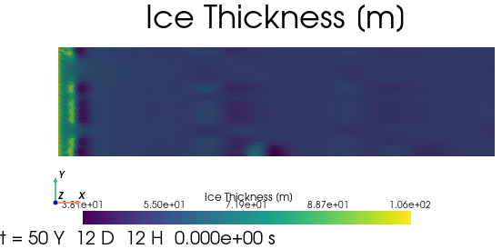
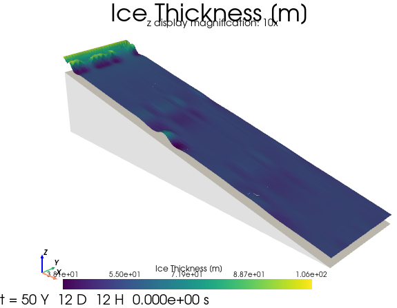
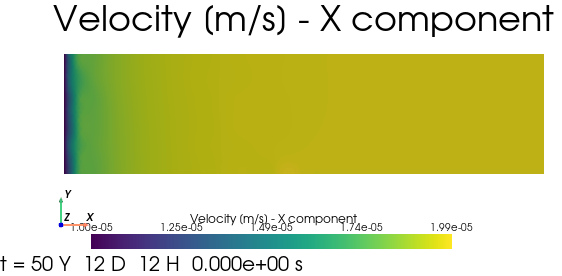

Shallow Ice Advance
===================

This example simulates an ice sheet that flows into a valley and spreads over
its bed. The ice is described by the depth-integrated equations of the
shallow-shelf approximation :cite:p:`Macayeal1989,Greve2009`, in which the
velocity is taken constant over the ice thickness. The momentum balance then
reduces to a two-dimensional problem for the depth-averaged velocity in map
view, coupled to the mass balance for the ice thickness. The ice margin, along
which the ice advances over the initially ice-free bed, is tracked by a level
set.

Set-up
------

The domain is the upper half of a symmetric valley,
:math:`20 \times 5\,\text{km}` (mesh generator ``Rectangle``,
:doc:`../../api/mesh_generators`, element size :math:`200\,\text{m}`). The
unknowns are the depth-averaged velocity ``v``, the ice thickness ``h`` and
the level set ``LS`` that marks the ice margin, solved one after the other in
each time step.

* ``Glaciology:ShallowIce``
  (:class:`femcubes.glaciology.shallow_ice.ShallowIce`) gives the momentum
  and mass balance, with the difference between the ice and ocean pressures
  on the ice front (the water level defaults to :math:`z = 0`) and Budd-type
  basal friction :cite:p:`Budd1979`, a drag proportional to the effective
  pressure at the bed and to the velocity.
* ``Glaciology:ShallowIceBC``
  (:class:`femcubes.glaciology.shallow_ice_bc.ShallowIceBC`) sets the boundary
  values: ice enters through the left edge with a velocity of
  :math:`10^{-5}\,\text{m/s}` (about 315 m/year) and a thickness of
  :math:`100\,\text{m}`, and the bottom edge (the valley centre line) and the
  top edge have zero normal velocity.
* ``Glaciology:LevelSet``
  (:class:`femcubes.glaciology.level_set.LevelSet`) moves the ice margin with
  the ice velocity; it is re-initialized every 10 steps.

Initially, 100 m of ice covers the first :math:`800\,\text{m}`. The
simulation covers 100 years in steps of 0.1 year (1000 steps).

The bed is selected with ``--case``:

``slope`` (default)
   rising towards the left edge at 2 %, from 0 m at the right edge to 400 m
   at the inflow;
``flat``
   at :math:`z = 0`.

Options
-------

``--case`` (``slope`` or ``flat``). The common options ``--quick``,
``--no-plots`` and ``--output-dir`` are described in :doc:`../index`;
``--quick`` runs three steps.

Running
-------

.. code-block:: bash

   python examples/glaciology/shallow_ice.py
   mpirun -n 4 python examples/glaciology/shallow_ice.py --case flat

The figures and movies of the velocity components, the thickness, the bed
elevation ``z`` and the ice phase of the level set, and a 3-D view of the
thickness (``RO_h``, vertical scale 10), are written to
``examples/glaciology/results/shallow_ice/<case>/``, or to the folder given by
``--output-dir``.

On four ranks, the 1000 steps of the ``slope`` case take about 39 min when the
field plots are drawn only at the end, as for the sample output below. By
default, the script draws the field plots and the movie frames at every step,
which makes each step several times slower; the run time with these default
settings has not been measured.

Sample output
-------------

The figures below are from the default ``slope`` case (44 000 degrees of
freedom) on four ranks, with the field plots drawn once at the end instead of
at every step and without the movies; the physics and the time stepping are
those of the script::

   mpirun -n 4 python docs/scripts/make_example_figures.py run \
       examples/glaciology/shallow_ice.py --final-plots-only -- --case slope

The simulation starts at :math:`t = -50` years, so the final state is
labelled 50 years. This label counts years of 365 days, whereas the script
uses years of 365.25 days, hence ``50 Y 12 D 12 H``.

   Ice thickness after 100 years.

   Ice thickness drawn on top of the bed, with a tenfold vertical exaggeration.

   Depth-averaged velocity in the flow direction after 100 years.

After 100 years, the ice covers the whole valley. The ice accelerates from the
imposed inflow velocity at the left edge as it flows down the bed slope, and
thins correspondingly as required by mass conservation. The thickness shows
small irregular variations, strongest close to the inflow edge.

The script performs a single pass over the velocity, thickness and level-set
steps per time step (``n_passes = 1``), so the three steps are not iterated
to a converged coupled state, and every time step ends with the solver
warning ``Reached 1 staggered passes with residuals above tolerance``. The
velocity step needs about 18 Newton iterations per time step, as its Jacobian
keeps the Glen viscosity fixed (a Picard-type linearization, see
:class:`~femcubes.glaciology.shallow_ice.ShallowIce`).

References
----------

.. bibliography::
   :filter: docname in docnames

Source code
-----------

.. literalinclude:: ../../../examples/glaciology/shallow_ice.py
   :language: python
   :caption: examples/glaciology/shallow_ice.py
