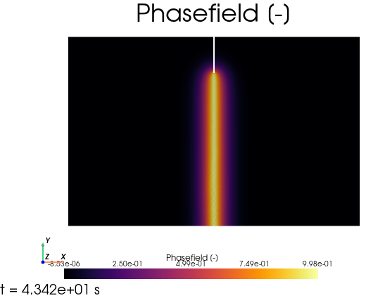
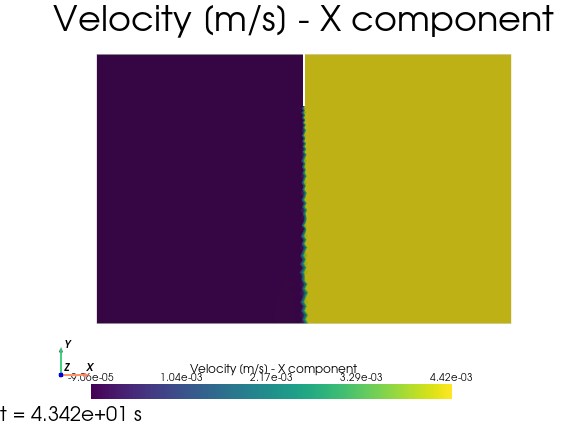
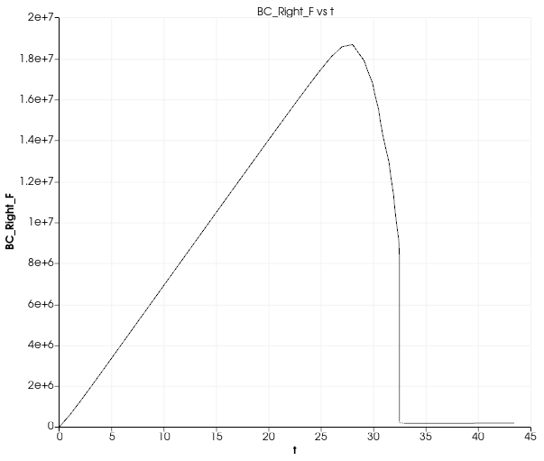
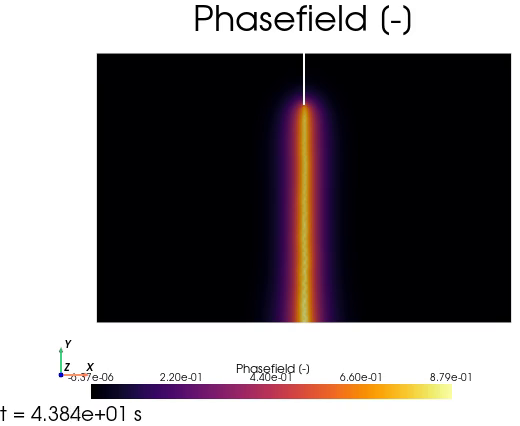

Tensile Ice Block
=================

This example pulls apart a notched block of ice, with a choice of six
rheologies, to compare viscous, elastic, viscoelastic and cohesive
descriptions of ice fracture on one simple set-up. Ice creeps under sustained
stress following Glen's flow law :cite:p:`Glen1955,CuffeyPaterson2010`, while
it can also fracture; the six models describe this combination in different
ways, from a viscous fluid with phase-field damage to the cohesive
phase-field model with creep :cite:p:`Hageman2026CMAME`.

Set-up
------

A :math:`200 \times 130\,\text{m}` ice block with
``--n-notches`` (default 1) surface notches of :math:`1\,\text{m}` width and
:math:`25\,\text{m}` depth, evenly spaced along the top (mesh generator
``Rectangle_Notches``, :doc:`../../api/mesh_generators`, uniform element size
:math:`\ell/4`). The block is fixed horizontally on its left edge and
vertically on its bed (``Boundary:PrescribedValue``,
:doc:`../../api/boundary/prescribed_value`); there is no gravity. The right edge
is controlled by ``Boundary:DisplacementControl``
(:doc:`../../api/boundary/displacement_control`), with a rate of
:math:`10^{-4}` per second on the horizontal displacement (velocity for the
``stokes`` and ``glen`` cases, whose unknown is the velocity). A 50-hour
spin-up with hourly steps precedes the loading, which starts at
:math:`t = 0` and lasts at most one hour with a time step of 1 s, reduced so
that the crack grows by at most one element per step. The run stops once
the force on the right edge has dropped below 5 % of its peak. The crack
depth is recorded by ``Solid:CrackDepthMeasure``
(:doc:`../../api/solids/crack_depth_measure`).

The phase field (``Solid:PhaseField``, :doc:`../../api/solids/phase_field`)
is combined with one of the solid models, selected with ``--case``:

``stokes`` / ``glen``
   viscous fluid with Newtonian or Glen viscosity (``Solid:Stokes``,
   :doc:`../../api/solids/stokes`), with phase-field damage;
``le`` / ``ve``
   standard AT2-type phase-field fracture of an elastic or a viscoelastic
   (Glen creep) solid (``Solid:LinearElastic``,
   :doc:`../../api/solids/linear_elastic`, and ``Solid:ViscoElastic``,
   :doc:`../../api/solids/viscoelastic`), with the fracture energy set from the
   tensile strength;
``le_cohesive`` / ``ve_cohesive``
   the cohesive phase-field model without and with Glen creep
   (``Solid:Cohesive_LinearElastic``,
   :doc:`../../api/solids/cohesive_linear_elastic`, and
   ``Solid:Cohesive_ViscoElastic``, :doc:`../../api/solids/cohesive_viscoelastic`).

Options
-------

``--case`` selects the rheology (default ``stokes``); ``--ell`` sets the
phase-field length scale (default 10 m, which also sets the element size);
``--n-notches`` sets the number of notches (default 1). The common options
``--quick``, ``--no-plots`` and ``--output-dir`` are described in
:doc:`../index`; ``--quick`` runs a 2-hour spin-up and stops at
:math:`t = 0.01\,\text{s}`.

Running
-------

.. code-block:: bash

   python examples/glaciology/tensile_ice.py --case ve_cohesive
   mpirun -n 4 python examples/glaciology/tensile_ice.py --case glen --n-notches 3

The figures and movies of the phase field and the two displacement (or
velocity) components, and the force on the right edge against time, are
written to ``examples/glaciology/results/tensile_ice/<case>/``, or to the
folder given by ``--output-dir``.

On four ranks, the default ``stokes`` case (130 000 degrees of freedom) takes
6.5 min with all plots and movies. The other cases have not been timed for
this page.

Sample output
-------------

The figures below are from the default ``stokes`` case on four ranks; the
simulation ends at :math:`t = 43\,\text{s}`, once the force has dropped.

   Phase field at the end of the simulation.

   Horizontal velocity at the end of the simulation.

   Force on the right edge (N/m) against time (s), with the loading starting
   at :math:`t = 0`.

A single crack grows from the notch tip down to the bed. The force grows
with the imposed velocity until the crack starts at about
:math:`t = 28\,\text{s}`, then falls while the crack runs through the block,
and drops to a small residual value once the crack has reached the bed. The
right half of the block then moves away from the left half.

The ``ve_cohesive`` results below were obtained with the previous version of
``Solid:Cohesive_ViscoElastic``, which solved its local problem with the C++
kernel (now ``Solid:Cohesive_ViscoElastic_Kernel``). The case now uses the
reduced local update and has not been rerun for this page. With the kernel
model (four ranks, default settings, 123 000 degrees of freedom), the
simulation did not finish: after the crack had started at about
:math:`t = 43\,\text{s}`, the displacement step repeatedly failed to converge
within 30 Newton iterations, the time step was reduced to its minimum of
:math:`10^{-8}\,\text{s}`, and the run stopped at :math:`t = 44.0\,\text{s}`.
As the figures are saved only at the end of a run, the figure below is the
last frame of the phase-field movie of that run.

   Phase field of the ``ve_cohesive`` case with the previous kernel model at
   :math:`t = 43.8\,\text{s}`.

Up to that point, the cohesive model gave the same crack path as the
``stokes`` case, from the notch tip to the bed, with a phase field that had
not yet reached one everywhere along the crack: in the cohesive model, the
phase field describes the gradual loss of cohesion along the crack rather
than a traction-free crack :cite:p:`Hageman2026CMAME`.

References
----------

.. bibliography::
   :filter: docname in docnames

Source code
-----------

.. literalinclude:: ../../../examples/glaciology/tensile_ice.py
   :language: python
   :caption: examples/glaciology/tensile_ice.py
